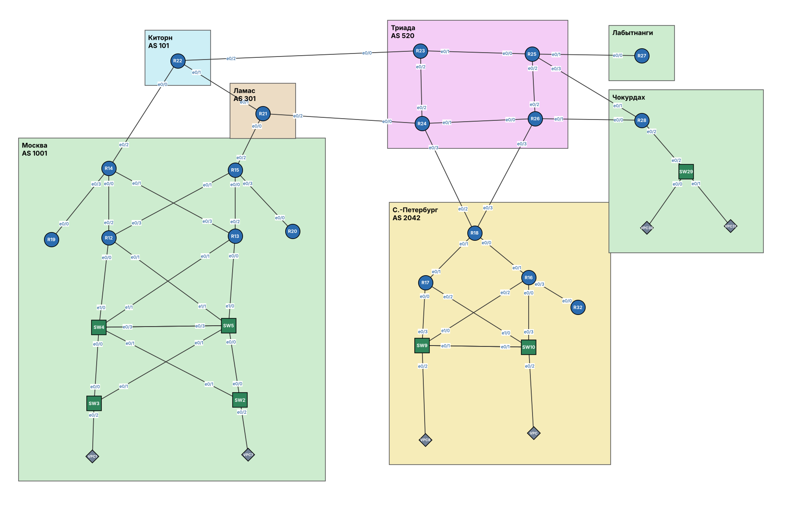

# Вводная документация

Репозиторий для оформления практических работ курса.

## Структура

Каждая работа лежит в отдельной папке `labs/labNN/`:

- `README.md`: задание, решение, проверка;
- `configs/`: итоговые конфигурации устройств (`show running-config`);
- `*.png`: схемы стенда.

## Стенд

Схема лабораторного стенда:

<!--  -->
