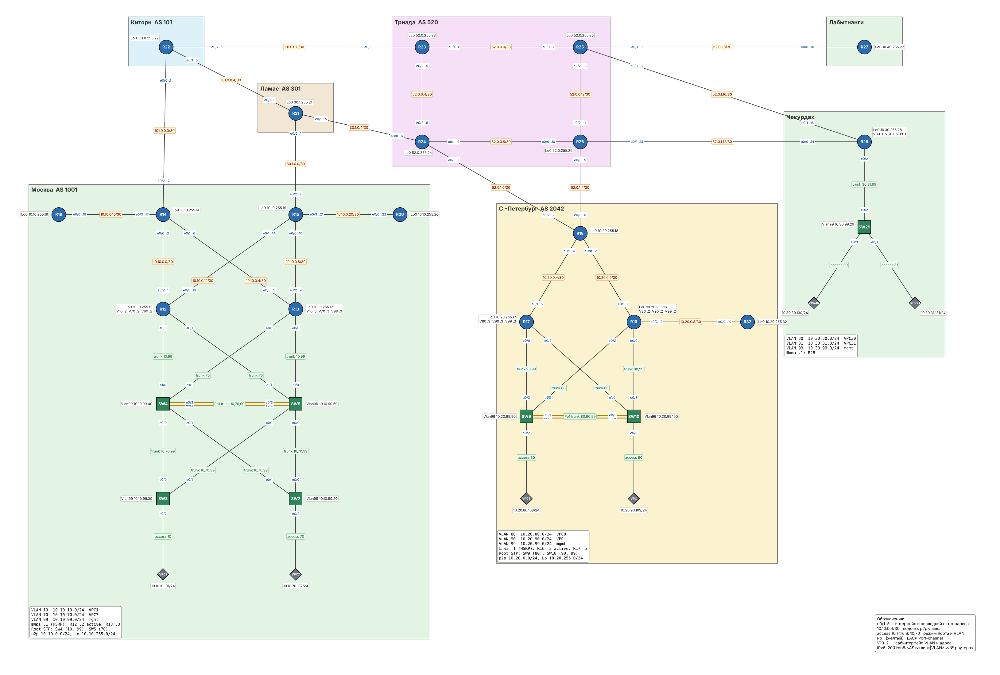

# Проектирование сети

### Задание

1. Разработать и задокументировать адресное пространство для лабораторного стенда.
2. Настроить IP-адреса на каждом активном порту.
3. Настроить каждый VPC в каждом офисе в своём VLAN.
4. Настроить VLAN/Loopback-интерфейс управления для сетевых устройств.
5. Настроить сети офисов так, чтобы не возникало broadcast-штормов, а использование линков было максимально оптимизировано.
6. Использовать IPv4. IPv6 по желанию.

### Решение

1. [Схема стенда](#1-схема-стенда)
2. [Принципы адресации](#2-принципы-адресации)
3. [Адресное пространство](#3-адресное-пространство)
   - [Блоки по автономным системам](#блоки-по-автономным-системам)
   - [Point-to-point линки](#point-to-point-линки)
   - [VLAN офисов](#vlan-офисов)
   - [Loopback-интерфейсы](#loopback-интерфейсы)
   - [Конечные устройства и управление коммутаторами](#конечные-устройства-и-управление-коммутаторами)
4. [Дизайн L2: VLAN, STP, EtherChannel](#4-дизайн-l2-vlan-stp-etherchannel)
5. [Примеры настройки](#5-примеры-настройки)
6. [Проверка](#6-проверка)
7. [Конфигурационные файлы](configs/)

Настроены IPv4 и IPv6. Файл стенда для EVE-NG со всеми конфигурациями: [lab01.unl](lab01.unl).

### 1. Схема стенда



### 2. Принципы адресации

- **Внутренние сети офисов** берутся из частного диапазона `10.0.0.0/8`, второй октет обозначает офис:
  `10.10.0.0/16` Москва, `10.20.0.0/16` С.-Петербург, `10.30.0.0/16` Чокурдах, `10.40.0.0/16` Лабытнанги.
- **Третий октет** внутри офиса: `0` для p2p-линков между роутерами, номер VLAN для пользовательских сегментов, `99` для управления, `255` для Loopback.
- **Сети провайдеров** берутся из блоков, условно принадлежащих их AS. Линк между провайдером и клиентом адресуется из блока провайдера, первый адрес `/30` получает провайдер.
- **Публичные блоки офисов** (AS1001, AS2042) зарезервированы под NAT и анонсы BGP в следующих работах.
- **IPv6**: каждой AS выделен `/48` из документационного `2001:db8::/32`, номер AS прямо в третьем хекстете (`2001:db8:1001::/48` для AS1001).
  Для p2p-линков четвёртый хекстет состоит из номеров роутеров по возрастанию (линк R12-R14: `2001:db8:1001:1214::/64`), для VLAN это номер VLAN.
- **Номер роутера** входит в адрес везде, где это возможно: Loopback `10.10.255.12` и `...:ffff::12` у R12, адрес в VLAN `.12`/`::12`, link-local `fe80::12`.
- Сети `/30` на p2p-линках, `/24` на пользовательских сегментах, `/32` и `/128` на Loopback.

### 3. Адресное пространство

#### Блоки по автономным системам

| Владелец | AS | IPv4 | IPv6 | Использование |
|---|---|---|---|---|
| Москва | 1001 | 10.10.0.0/16 (внутр.), 100.1.0.0/24 (публ.) | 2001:db8:1001::/48 | офис |
| С.-Петербург | 2042 | 10.20.0.0/16 (внутр.), 20.42.0.0/24 (публ.) | 2001:db8:2042::/48 | офис |
| Чокурдах | 1001 | 10.30.0.0/16 | 2001:db8:1001:2800::/56 | офис |
| Лабытнанги | 1001 | 10.40.0.0/16 | 2001:db8:1001:2700::/56 | офис |
| Киторн | 101 | 101.0.0.0/16 | 2001:db8:101::/48 | провайдер |
| Ламас | 301 | 30.1.0.0/16 | 2001:db8:301::/48 | провайдер |
| Триада | 520 | 52.0.0.0/16 | 2001:db8:520::/48 | провайдер |

Внутри блока провайдера: `x.x.0.0/24` линки между роутерами провайдеров, `52.0.1.0/24` линки Триады к клиентам, `x.x.255.0/24` Loopback.

#### Point-to-point линки

| Сторона A | Сторона B | Сеть IPv4 | Адреса A / B | Сеть IPv6 | Владелец блока |
|---|---|---|---|---|---|
| R12 e0/2 | R14 e0/0 | 10.10.0.0/30 | 10.10.0.1 / 10.10.0.2 | 2001:db8:1001:1214::/64 | Москва |
| R13 e0/3 | R14 e0/1 | 10.10.0.4/30 | 10.10.0.5 / 10.10.0.6 | 2001:db8:1001:1314::/64 | Москва |
| R13 e0/2 | R15 e0/0 | 10.10.0.8/30 | 10.10.0.9 / 10.10.0.10 | 2001:db8:1001:1315::/64 | Москва |
| R12 e0/3 | R15 e0/1 | 10.10.0.12/30 | 10.10.0.13 / 10.10.0.14 | 2001:db8:1001:1215::/64 | Москва |
| R14 e0/3 | R19 e0/0 | 10.10.0.16/30 | 10.10.0.17 / 10.10.0.18 | 2001:db8:1001:1419::/64 | Москва |
| R15 e0/3 | R20 e0/0 | 10.10.0.20/30 | 10.10.0.21 / 10.10.0.22 | 2001:db8:1001:1520::/64 | Москва |
| R16 e0/1 | R18 e0/0 | 10.20.0.0/30 | 10.20.0.1 / 10.20.0.2 | 2001:db8:2042:1618::/64 | С.-Петербург |
| R17 e0/1 | R18 e0/1 | 10.20.0.4/30 | 10.20.0.5 / 10.20.0.6 | 2001:db8:2042:1718::/64 | С.-Петербург |
| R16 e0/3 | R32 e0/0 | 10.20.0.8/30 | 10.20.0.9 / 10.20.0.10 | 2001:db8:2042:1632::/64 | С.-Петербург |
| R22 e0/0 | R14 e0/2 | 101.0.0.0/30 | 101.0.0.1 / 101.0.0.2 | 2001:db8:101:1422::/64 | Киторн |
| R22 e0/1 | R21 e0/1 | 101.0.0.4/30 | 101.0.0.5 / 101.0.0.6 | 2001:db8:101:2122::/64 | Киторн |
| R22 e0/2 | R23 e0/0 | 101.0.0.8/30 | 101.0.0.9 / 101.0.0.10 | 2001:db8:101:2223::/64 | Киторн |
| R21 e0/0 | R15 e0/2 | 30.1.0.0/30 | 30.1.0.1 / 30.1.0.2 | 2001:db8:301:1521::/64 | Ламас |
| R21 e0/2 | R24 e0/0 | 30.1.0.4/30 | 30.1.0.5 / 30.1.0.6 | 2001:db8:301:2124::/64 | Ламас |
| R23 e0/1 | R25 e0/0 | 52.0.0.0/30 | 52.0.0.1 / 52.0.0.2 | 2001:db8:520:2325::/64 | Триада |
| R23 e0/2 | R24 e0/2 | 52.0.0.4/30 | 52.0.0.5 / 52.0.0.6 | 2001:db8:520:2324::/64 | Триада |
| R24 e0/1 | R26 e0/0 | 52.0.0.8/30 | 52.0.0.9 / 52.0.0.10 | 2001:db8:520:2426::/64 | Триада |
| R25 e0/2 | R26 e0/2 | 52.0.0.12/30 | 52.0.0.13 / 52.0.0.14 | 2001:db8:520:2526::/64 | Триада |
| R24 e0/3 | R18 e0/2 | 52.0.1.0/30 | 52.0.1.1 / 52.0.1.2 | 2001:db8:520:1824::/64 | Триада |
| R26 e0/3 | R18 e0/3 | 52.0.1.4/30 | 52.0.1.5 / 52.0.1.6 | 2001:db8:520:1826::/64 | Триада |
| R25 e0/1 | R27 e0/0 | 52.0.1.8/30 | 52.0.1.9 / 52.0.1.10 | 2001:db8:520:2527::/64 | Триада |
| R26 e0/1 | R28 e0/0 | 52.0.1.12/30 | 52.0.1.13 / 52.0.1.14 | 2001:db8:520:2628::/64 | Триада |
| R25 e0/3 | R28 e0/1 | 52.0.1.16/30 | 52.0.1.17 / 52.0.1.18 | 2001:db8:520:2528::/64 | Триада |

#### VLAN офисов

| Офис | VLAN | Имя | Назначение | IPv4 | IPv6 | Шлюз (VIP) | Интерфейсы роутеров |
|---|---|---|---|---|---|---|---|
| Москва | 10 | USERS-VPC1 | VPC1 | 10.10.10.0/24 | 2001:db8:1001:10::/64 | 10.10.10.1 | R12 e0/0.10 (10.10.10.2), R13 e0/0.10 (10.10.10.3) |
| Москва | 70 | USERS-VPC7 | VPC7 | 10.10.70.0/24 | 2001:db8:1001:70::/64 | 10.10.70.1 | R12 e0/1.70 (10.10.70.2), R13 e0/1.70 (10.10.70.3) |
| Москва | 99 | MGMT | управление: SVI Vlan99 на SW2-SW5, шлюз для них R12/R13 | 10.10.99.0/24 | 2001:db8:1001:99::/64 | 10.10.99.1 | R12 e0/0.99 (10.10.99.2), R13 e0/0.99 (10.10.99.3) |
| С.-Петербург | 80 | USERS-VPC8 | VPC8 | 10.20.80.0/24 | 2001:db8:2042:80::/64 | 10.20.80.1 | R16 e0/2.80 (10.20.80.2), R17 e0/2.80 (10.20.80.3) |
| С.-Петербург | 90 | USERS-VPC | VPC | 10.20.90.0/24 | 2001:db8:2042:90::/64 | 10.20.90.1 | R16 e0/0.90 (10.20.90.2), R17 e0/0.90 (10.20.90.3) |
| С.-Петербург | 99 | MGMT | управление: SVI Vlan99 на SW9-SW10, шлюз для них R16/R17 | 10.20.99.0/24 | 2001:db8:2042:99::/64 | 10.20.99.1 | R16 e0/0.99 (10.20.99.2), R17 e0/0.99 (10.20.99.3) |
| Чокурдах | 30 | USERS-VPC30 | VPC30 | 10.30.30.0/24 | 2001:db8:1001:2830::/64 | 10.30.30.1 | R28 e0/2.30 (10.30.30.1) |
| Чокурдах | 31 | USERS-VPC31 | VPC31 | 10.30.31.0/24 | 2001:db8:1001:2831::/64 | 10.30.31.1 | R28 e0/2.31 (10.30.31.1) |
| Чокурдах | 99 | MGMT | управление: SVI Vlan99 на SW29, шлюз R28 | 10.30.99.0/24 | 2001:db8:1001:2899::/64 | 10.30.99.1 | R28 e0/2.99 (10.30.99.1) |

**Управление.** Коммутаторы управляются через SVI `Vlan99` (адреса в таблице ниже), роутеры через `Loopback0` (см. раздел «Loopback-интерфейсы»): Loopback не зависит от состояния физических линков и доступен по любому живому пути. Адреса роутеров в VLAN 99 служат шлюзом для сети управления коммутаторов, а не адресом управления самих роутеров.

VLAN 999 используется как native на всех транках и как VLAN для неиспользуемых портов, пользовательский трафик в нём не передаётся.

#### Loopback-интерфейсы

Loopback0 на каждом роутере служит интерфейсом управления и будущим Router-ID для OSPF, IS-IS, EIGRP и BGP.

| Устройство | Площадка | Loopback0 IPv4 | Loopback0 IPv6 |
|---|---|---|---|
| R12 | Москва | 10.10.255.12/32 | 2001:db8:1001:ffff::12/128 |
| R13 | Москва | 10.10.255.13/32 | 2001:db8:1001:ffff::13/128 |
| R14 | Москва | 10.10.255.14/32 | 2001:db8:1001:ffff::14/128 |
| R15 | Москва | 10.10.255.15/32 | 2001:db8:1001:ffff::15/128 |
| R16 | С.-Петербург | 10.20.255.16/32 | 2001:db8:2042:ffff::16/128 |
| R17 | С.-Петербург | 10.20.255.17/32 | 2001:db8:2042:ffff::17/128 |
| R18 | С.-Петербург | 10.20.255.18/32 | 2001:db8:2042:ffff::18/128 |
| R19 | Москва | 10.10.255.19/32 | 2001:db8:1001:ffff::19/128 |
| R20 | Москва | 10.10.255.20/32 | 2001:db8:1001:ffff::20/128 |
| R21 | Ламас | 30.1.255.21/32 | 2001:db8:301:ffff::21/128 |
| R22 | Киторн | 101.0.255.22/32 | 2001:db8:101:ffff::22/128 |
| R23 | Триада | 52.0.255.23/32 | 2001:db8:520:ffff::23/128 |
| R24 | Триада | 52.0.255.24/32 | 2001:db8:520:ffff::24/128 |
| R25 | Триада | 52.0.255.25/32 | 2001:db8:520:ffff::25/128 |
| R26 | Триада | 52.0.255.26/32 | 2001:db8:520:ffff::26/128 |
| R27 | Лабытнанги | 10.40.255.27/32 | 2001:db8:1001:27ff::27/128 |
| R28 | Чокурдах | 10.30.255.28/32 | 2001:db8:1001:28ff::28/128 |
| R32 | С.-Петербург | 10.20.255.32/32 | 2001:db8:2042:ffff::32/128 |

#### Конечные устройства и управление коммутаторами

| Устройство | IPv4 | Шлюз | IPv6 |
|---|---|---|---|
| VPC1 | 10.10.10.101/24 | 10.10.10.1 | 2001:db8:1001:10::101/64 |
| VPC7 | 10.10.70.107/24 | 10.10.70.1 | 2001:db8:1001:70::107/64 |
| VPC8 | 10.20.80.108/24 | 10.20.80.1 | 2001:db8:2042:80::108/64 |
| VPC | 10.20.90.109/24 | 10.20.90.1 | 2001:db8:2042:90::109/64 |
| VPC30 | 10.30.30.130/24 | 10.30.30.1 | 2001:db8:1001:2830::130/64 |
| VPC31 | 10.30.31.131/24 | 10.30.31.1 | 2001:db8:1001:2831::131/64 |
| SW2 | 10.10.99.20/24 | 10.10.99.1 | - |
| SW3 | 10.10.99.30/24 | 10.10.99.1 | - |
| SW4 | 10.10.99.40/24 | 10.10.99.1 | - |
| SW5 | 10.10.99.50/24 | 10.10.99.1 | - |
| SW9 | 10.20.99.90/24 | 10.20.99.1 | - |
| SW10 | 10.20.99.100/24 | 10.20.99.1 | - |
| SW29 | 10.30.99.29/24 | 10.30.99.1 | - |

IPv6 на VPC задан статически, связность внутри сегмента проверяется пингом до адреса роутера.

### 4. Дизайн L2: VLAN, STP, EtherChannel

**Защита от broadcast-штормов.** В офисах Москва и С.-Петербург коммутаторы соединены с избыточностью, поэтому на всех коммутаторах включён Rapid PVST+. Порты к VPC настроены как `portfast edge` с `bpduguard`, неиспользуемые порты выключены и переведены в VLAN 999.

**VTP.** Коммутаторы переведены в `vtp mode transparent`: VLAN задаются локально на каждом коммутаторе и хранятся в конфигурации. В режиме VTP server, который включён по умолчанию, строки `vlan` из startup-config при загрузке игнорируются, и VLAN не создаются.

**Оптимизация линков:**

- Два параллельных линка между коммутаторами распределения (SW4-SW5 в Москве, SW9-SW10 в С.-Петербурге) объединены в `Port-channel1` по LACP. Оба линка передают трафик, а STP видит их как один.
- Корень STP назначается отдельно для каждого VLAN, чтобы разные VLAN блокировали разные аплинки коммутаторов доступа:

  | Офис | VLAN | Root primary | Root secondary |
  |---|---|---|---|
  | Москва | 10, 99 | SW4 | SW5 |
  | Москва | 70 | SW5 | SW4 |
  | С.-Петербург | 80 | SW9 | SW10 |
  | С.-Петербург | 90, 99 | SW10 | SW9 |

- Шлюзы VLAN резервированы через HSRPv2 (виртуальный адрес `.1`, R12/R16 активные с приоритетом 110, R13/R17 резервные).
  Каждый роутер подключён к обоим коммутаторам распределения. Сабинтерфейсы VLAN разнесены по портам так, что у каждого VLAN один шлюз висит на SW4, другой на SW5 (в С.-Петербурге на SW9 и SW10), а активный шлюз подключён к корню STP этого VLAN.
  В итоге задействованы все четыре линка от роутеров к коммутаторам, отказ одного коммутатора или одного роутера не оставляет VLAN без шлюза, а трафик к активному шлюзу идёт по кратчайшему пути без блокированных портов.

  | Роутер | Порт | Коммутатор | VLAN |
  |---|---|---|---|
  | R12 | e0/0 | SW4 e1/0 | 10, 99 |
  | R12 | e0/1 | SW5 e1/1 | 70 |
  | R13 | e0/0 | SW5 e1/0 | 10, 99 |
  | R13 | e0/1 | SW4 e1/1 | 70 |
  | R16 | e0/2 | SW9 e1/0 | 80 |
  | R16 | e0/0 | SW10 e0/3 | 90, 99 |
  | R17 | e0/2 | SW10 e1/0 | 80 |
  | R17 | e0/0 | SW9 e0/3 | 90, 99 |

- На транках к роутерам разрешены только нужные VLAN, порты переведены в `portfast edge trunk`: роутер не участвует в STP, и порт не ждёт перехода в forwarding.

В Чокурдахе один коммутатор SW29 без избыточных линков, R28 работает как router-on-a-stick для VLAN 30, 31 и 99.

### 5. Примеры настройки

Сабинтерфейс с HSRP на R12:

```
interface Ethernet0/0.10
 description VLAN10 USERS-VPC1
 encapsulation dot1Q 10
 ip address 10.10.10.2 255.255.255.0
 ipv6 address fe80::12 link-local
 ipv6 address 2001:db8:1001:10::12/64
 standby version 2
 standby 10 ip 10.10.10.1
 standby 10 priority 110
 standby 10 preempt
```

STP и EtherChannel на SW4:

```
vtp mode transparent
!
spanning-tree mode rapid-pvst
spanning-tree vlan 10,99 root primary
spanning-tree vlan 70 root secondary
!
interface Port-channel1
 switchport trunk encapsulation dot1q
 switchport trunk native vlan 999
 switchport trunk allowed vlan 10,70,99
 switchport mode trunk
!
interface range Ethernet0/2 - 3
 switchport trunk encapsulation dot1q
 switchport trunk native vlan 999
 switchport trunk allowed vlan 10,70,99
 switchport mode trunk
 channel-group 1 mode active
```

Порт доступа и управление на SW3:

```
interface Ethernet0/2
 description VPC1
 switchport mode access
 switchport access vlan 10
 spanning-tree portfast edge
 spanning-tree bpduguard enable
!
interface Vlan99
 ip address 10.10.99.30 255.255.255.0
!
ip default-gateway 10.10.99.1
```

Настройка VPC1:

```
ip 10.10.10.101/24 10.10.10.1
ip 2001:db8:1001:10::101/64
```

### 6. Проверка

На этом этапе маршрутизация не настроена, поэтому проверяется работа L2 и связность в пределах сегментов: VLAN и STP на коммутаторах, EtherChannel, HSRP, доступность шлюза с VPC и адреса на p2p-линках.

#### VLAN и корень STP на SW4

SW4 является корнем для VLAN 10, все его порты в этом VLAN назначенные (Desg) и передают трафик.

```
SW4#show vlan brief

VLAN Name                             Status    Ports
---- -------------------------------- --------- -------------------------------
1    default                          active
10   USERS-VPC1                       active
70   USERS-VPC7                       active
99   MGMT                             active
999  NATIVE-UNUSED                    active    Et1/2, Et1/3

SW4#show spanning-tree vlan 10

VLAN0010
  Spanning tree enabled protocol rstp
  Root ID    Priority    24586
             Address     aabb.cc00.4000
             This bridge is the root
             Hello Time   2 sec  Max Age 20 sec  Forward Delay 15 sec

  Bridge ID  Priority    24586  (priority 24576 sys-id-ext 10)
             Address     aabb.cc00.4000
             Hello Time   2 sec  Max Age 20 sec  Forward Delay 15 sec
             Aging Time  300 sec

Interface           Role Sts Cost      Prio.Nbr Type
------------------- ---- --- --------- -------- --------------------------------
Et0/0               Desg FWD 100       128.1    Shr
Et0/1               Desg FWD 100       128.2    Shr
Et1/0               Desg FWD 100       128.5    Shr
Po1                 Desg FWD 56        128.65   Shr
```

#### EtherChannel между SW4 и SW5

Оба линка собраны в Po1 по LACP (флаг `P`), канал работает как L2 (`SU`).

```
SW4#show etherchannel summary
Number of channel-groups in use: 1
Number of aggregators:           1

Group  Port-channel  Protocol    Ports
------+-------------+-----------+-----------------------------------------------
1      Po1(SU)         LACP      Et0/2(P)    Et0/3(P)
```

#### Транки к роутерам на SW5

На портах к роутерам разрешены только VLAN своего сабинтерфейса.

```
SW5#show interfaces trunk

Port        Mode             Encapsulation  Status        Native vlan
Et0/0       on               802.1q         trunking      999
Et0/1       on               802.1q         trunking      999
Et1/0       on               802.1q         trunking      999
Et1/1       on               802.1q         trunking      999
Po1         on               802.1q         trunking      999

Port        Vlans allowed on trunk
Et0/0       10,70,99
Et0/1       10,70,99
Et1/0       10,99
Et1/1       70
Po1         10,70,99
```

#### HSRP

R12 активный шлюз во всех VLAN Москвы, R13 резервный.

```
R13#show standby brief
                     P indicates configured to preempt.
                     |
Interface   Grp  Pri P State   Active          Standby         Virtual IP
Et0/0.10    10   100 P Standby 10.10.10.2      local           10.10.10.1
Et0/0.99    99   100 P Standby 10.10.99.2      local           10.10.99.1
Et0/1.70    70   100 P Standby 10.10.70.2      local           10.10.70.1
```

#### Связность VPC1 со шлюзом

```
VPC1> ping 10.10.10.1

84 bytes from 10.10.10.1 icmp_seq=1 ttl=255 time=0.566 ms
84 bytes from 10.10.10.1 icmp_seq=2 ttl=255 time=0.618 ms
84 bytes from 10.10.10.1 icmp_seq=3 ttl=255 time=0.660 ms

VPC1> ping 2001:db8:1001:10::12

2001:db8:1001:10::12 icmp6_seq=1 ttl=64 time=1.001 ms
2001:db8:1001:10::12 icmp6_seq=2 ttl=64 time=0.558 ms
```

#### Адреса на интерфейсах роутеров

Все интерфейсы R14 подняты, линк к провайдеру Киторн работает (первый пакет потерян на время ARP-разрешения).

```
R14#show ip interface brief
Interface                  IP-Address      OK? Method Status                Protocol
Ethernet0/0                10.10.0.2       YES TFTP   up                    up
Ethernet0/1                10.10.0.6       YES TFTP   up                    up
Ethernet0/2                101.0.0.2       YES TFTP   up                    up
Ethernet0/3                10.10.0.17      YES TFTP   up                    up
Loopback0                  10.10.255.14    YES TFTP   up                    up

R14#ping 101.0.0.1
Sending 5, 100-byte ICMP Echos to 101.0.0.1, timeout is 2 seconds:
.!!!!
Success rate is 80 percent (4/5), round-trip min/avg/max = 1/1/1 ms
```

Полные конфигурации всех устройств приведены [здесь](configs/).
