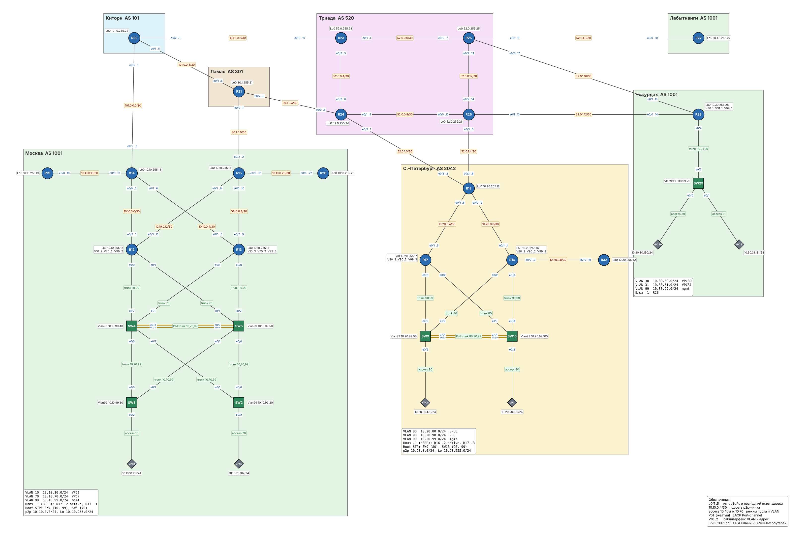

# IS-IS

### Задание

Настроить IS-IS в ISP Триада:
1. R23 и R25 находятся в зоне 2222.
2. R24 находится в зоне 24.
3. R26 находится в зоне 26.
4. Настроить IS-IS для IPv4 и IPv6.

### Решение

1. [Схема и параметры](#1-схема-и-параметры)
2. [Уровни и соседства](#2-уровни-и-соседства)
3. [Примеры настройки](#3-примеры-настройки)
4. [Проверка](#4-проверка)
5. [Конфигурационные файлы](configs/)

Работа продолжает [лабу 03](../lab03/), изменения затронули только роутеры Триады (R23-R26). Файл стенда для EVE-NG: [lab04.unl](lab04.unl).

### 1. Схема и параметры



| Роутер | Area | NET | Уровень | Loopback0 |
|---|---|---|---|---|
| R23 | 49.2222 | 49.2222.0520.0000.0023.00 | L1/L2 | 52.0.255.23, 2001:db8:520:ffff::23 |
| R25 | 49.2222 | 49.2222.0520.0000.0025.00 | L1/L2 | 52.0.255.25, 2001:db8:520:ffff::25 |
| R24 | 49.0024 | 49.0024.0520.0000.0024.00 | L2 | 52.0.255.24, 2001:db8:520:ffff::24 |
| R26 | 49.0026 | 49.0026.0520.0000.0026.00 | L2 | 52.0.255.26, 2001:db8:520:ffff::26 |

- **NET.** AFI `49` (приватная адресация), за ним номер области из задания. System ID `0520.0000.00NN` собран из номера AS Триады и номера роутера, поэтому он уникален и по нему сразу понятно, чей это роутер.
- **IPv6** работает в режиме **multi-topology**: у IPv4 и IPv6 отдельные SPF, и сбой IPv6 на одном линке не ломает IPv4. Для multi-topology нужны широкие метрики (`metric-style wide`), они же снимают ограничение в 63 на метрику интерфейса.
- **Линки между роутерами** переведены в `point-to-point`: на сегменте из двух роутеров DIS не нужен, а соседство поднимается быстрее.
- **Loopback и линки к клиентам Триады** (`52.0.1.0/24`: R18, R27, R28) объявлены `passive-interface`: их сети попадают в IS-IS, но соседство через них не строится. Линки к другим провайдерам (Киторн, Ламас) в IS-IS не включены, это адреса чужих AS.
- **Временные статические маршруты** между Loopback R25 и R26 из [лабы 02](../lab02/) удалены, теперь их даёт IS-IS. Статические маршруты до сетей клиентов (Чокурдах, Лабытнанги) останутся до лабы по BGP.

### 2. Уровни и соседства

IS-IS строит соседства L1 только внутри одной области, а связь между областями идёт по L2. Поэтому:
- **R23 и R25** в одной области 49.2222. Между ними соседство L1 и L2, оба роутера L1/L2: через L2 они связаны с остальной Триадой.
- **R24 и R26** в своих областях одни, L1 им не нужен, поэтому они настроены как `is-type level-2-only`.
- **Линки R23-R24 и R25-R26** ведут в другие области, поэтому на стороне R23 и R25 они переведены в `isis circuit-type level-2-only`. Иначе роутеры зря слали бы туда L1 hello.

Магистраль L2 проходит через все четыре роутера: R23-R24-R26-R25-R23.

### 3. Примеры настройки

R25 (L1/L2, area 2222):
```
router isis TRIADA
 net 49.2222.0520.0000.0025.00
 metric-style wide
 log-adjacency-changes
 passive-interface Loopback0
 passive-interface Ethernet0/1
 passive-interface Ethernet0/3
 !
 address-family ipv6
  multi-topology
 exit-address-family
!
interface Ethernet0/0
 description to R23
 ip router isis TRIADA
 ipv6 router isis TRIADA
 isis network point-to-point
!
interface Ethernet0/2
 description to R26
 ip router isis TRIADA
 ipv6 router isis TRIADA
 isis network point-to-point
 isis circuit-type level-2-only
```

R24 (L2, area 24):
```
router isis TRIADA
 net 49.0024.0520.0000.0024.00
 is-type level-2-only
 metric-style wide
 log-adjacency-changes
 passive-interface Loopback0
 passive-interface Ethernet0/3
 !
 address-family ipv6
  multi-topology
 exit-address-family
!
interface Ethernet0/1
 description to R26
 ip router isis TRIADA
 ipv6 router isis TRIADA
 isis network point-to-point
!
interface Ethernet0/2
 description to R23
 ip router isis TRIADA
 ipv6 router isis TRIADA
 isis network point-to-point
```

### 4. Проверка

#### Соседства

У R23 сосед R25 на обоих уровнях и сосед R24 только на L2:
```
R23#show isis neighbors

Tag TRIADA:
System Id      Type Interface   IP Address      State Holdtime Circuit Id
R24            L2   Et0/2       52.0.0.6        UP    25       01
R25            L1L2 Et0/1       52.0.0.2        UP    23       00
```

У R24 оба соседа только на L2:
```
R24#show isis neighbors

Tag TRIADA:
System Id      Type Interface   IP Address      State Holdtime Circuit Id
R23            L2   Et0/2       52.0.0.5        UP    27       01
R26            L2   Et0/1       52.0.0.10       UP    25       00
```

#### База LSP

В L1-базе R25 только роутеры области 49.2222 (R23 и R25), у их LSP выставлен бит ATT: они связаны с другими областями. В L2-базе все четыре роутера Триады:
```
R25#show isis database

Tag TRIADA:
IS-IS Level-1 Link State Database:
LSPID                 LSP Seq Num  LSP Checksum  LSP Holdtime      ATT/P/OL
R23.00-00             0x00000003   0x4605        1144              1/0/0
R25.00-00           * 0x00000002   0xCE56        1146              1/0/0
IS-IS Level-2 Link State Database:
LSPID                 LSP Seq Num  LSP Checksum  LSP Holdtime      ATT/P/OL
R23.00-00             0x00000004   0x3A73        1149              0/0/0
R24.00-00             0x00000001   0xBE22        1148              0/0/0
R25.00-00           * 0x00000002   0x0DB6        1146              0/0/0
R26.00-00             0x00000003   0x3D70        1149              0/0/0
```

#### Таблицы маршрутизации

R23 видит все сети Триады. Сети соседа по области (R25) приходят как `L1`, остальные как `L2`. До R26 и его клиентских линков два равноценных пути (ECMP):
```
R23#show ip route isis

      52.0.0.0/8 is variably subnetted, 15 subnets, 2 masks
i L2     52.0.0.8/30 [115/20] via 52.0.0.6, 00:00:55, Ethernet0/2
i L2     52.0.0.12/30 [115/20] via 52.0.0.2, 00:01:05, Ethernet0/1
i L2     52.0.1.0/30 [115/10] via 52.0.0.6, 00:00:55, Ethernet0/2
i L2     52.0.1.4/30 [115/20] via 52.0.0.6, 00:00:55, Ethernet0/2
                     [115/20] via 52.0.0.2, 00:00:55, Ethernet0/1
i L1     52.0.1.8/30 [115/10] via 52.0.0.2, 00:01:05, Ethernet0/1
i L2     52.0.1.12/30 [115/20] via 52.0.0.6, 00:00:55, Ethernet0/2
                      [115/20] via 52.0.0.2, 00:00:55, Ethernet0/1
i L1     52.0.1.16/30 [115/10] via 52.0.0.2, 00:01:05, Ethernet0/1
i L2     52.0.255.24/32 [115/10] via 52.0.0.6, 00:00:55, Ethernet0/2
i L1     52.0.255.25/32 [115/10] via 52.0.0.2, 00:01:05, Ethernet0/1
i L2     52.0.255.26/32 [115/20] via 52.0.0.6, 00:00:55, Ethernet0/2
                        [115/20] via 52.0.0.2, 00:00:55, Ethernet0/1
```

R26 работает только на L2, поэтому все маршруты у него `L2`:
```
R26#show ip route isis

      52.0.0.0/8 is variably subnetted, 17 subnets, 2 masks
i L2     52.0.0.0/30 [115/20] via 52.0.0.13, 00:01:19, Ethernet0/2
i L2     52.0.0.4/30 [115/20] via 52.0.0.9, 00:01:08, Ethernet0/0
i L2     52.0.1.0/30 [115/10] via 52.0.0.9, 00:01:08, Ethernet0/0
i L2     52.0.1.8/30 [115/10] via 52.0.0.13, 00:01:19, Ethernet0/2
i L2     52.0.1.16/30 [115/10] via 52.0.0.13, 00:01:19, Ethernet0/2
i L2     52.0.255.23/32 [115/20] via 52.0.0.13, 00:01:08, Ethernet0/2
                        [115/20] via 52.0.0.9, 00:01:08, Ethernet0/0
i L2     52.0.255.24/32 [115/10] via 52.0.0.9, 00:01:08, Ethernet0/0
i L2     52.0.255.25/32 [115/10] via 52.0.0.13, 00:01:19, Ethernet0/2
```

#### Связность IPv4 и IPv6

R24 (область 24) достаёт до Loopback R25 (область 2222) по обоим протоколам:
```
R24#ping 52.0.255.25 source Loopback0
Packet sent with a source address of 52.0.255.24
!!!!!
Success rate is 100 percent (5/5), round-trip min/avg/max = 1/1/1 ms

R24#ping 2001:db8:520:ffff::25 source Loopback0
Packet sent with a source address of 2001:DB8:520:FFFF::24
!!!!!
Success rate is 100 percent (5/5), round-trip min/avg/max = 1/1/1 ms
```
