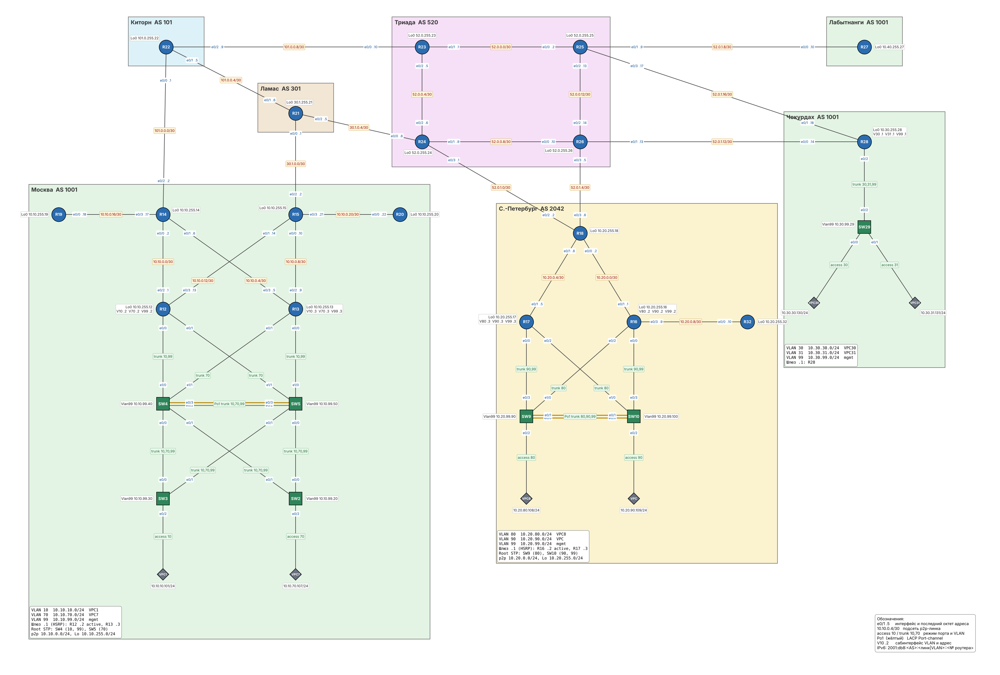

# VPN. IPSec

### Задание

1. Настроить GRE поверх IPSec между офисами Москва и С.-Петербург.
2. Настроить DMVPN поверх IPSec между офисами Москва и Чокурдах, Лабытнанги.
3. Все узлы в офисах в лабораторной работе должны иметь IP-связность.
4. Для аутентификации использовать сертификаты, выданные собственным центром сертификации (CA).

### Решение

1. [Схема](#1-схема)
2. [Центр сертификации](#2-центр-сертификации)
3. [Параметры IPSec](#3-параметры-ipsec)
4. [Защита туннелей](#4-защита-туннелей)
5. [Выпуск сертификатов](#5-выпуск-сертификатов)
6. [Проверка](#6-проверка)
7. [Конфигурационные файлы](configs/)

Работа продолжает [лабу 11](../lab11/): туннели GRE и DMVPN и маршрутизация через них не менялись, к ним добавлено шифрование. Файл стенда для EVE-NG: [lab12.unl](lab12.unl).

### 1. Схема



| Туннель | Участники | Внешние адреса |
|---|---|---|
| GRE, Tunnel0 | R15 - R18 | 100.1.0.15 - 20.42.0.18 |
| DMVPN, Tunnel1 | хаб R14, споки R27, R28 | 100.1.0.14; 52.0.1.10; 52.0.1.14 |

| Роль | Роутер | Адрес |
|---|---|---|
| Центр сертификации OTUS-CA | R14 | http://100.1.0.14 (SCEP) |
| Клиенты CA | R14, R15, R18, R27, R28 | trustpoint `OTUS` |

### 2. Центр сертификации

CA развёрнут на R14 встроенным в IOS сервером сертификатов. R14 выбран потому, что его адрес `100.1.0.14` из публичного блока Москвы доступен всем участникам туннелей без самих туннелей: сертификат нужен до того, как туннель поднимется.

```
ip http server
!
crypto pki server OTUS-CA
 database level minimum
 issuer-name CN=OTUS-CA,O=OTUS
 grant auto
 lifetime certificate 365
 lifetime ca-certificate 1825
```

- **`grant auto`.** Запросы сертификатов подписываются автоматически. Для лаборатории это удобно, в реальной сети запросы одобряет администратор (`crypto pki server OTUS-CA grant`).
- **`database level minimum`.** CA не хранит выданные сертификаты целиком, только их серийные номера: в NVRAM роутера мало места.
- Сертификат самого CA действует 5 лет, сертификаты роутеров 1 год.

На каждом роутере описан trustpoint, через который он получает сертификат от CA по протоколу SCEP:
```
crypto pki trustpoint OTUS
 enrollment url http://100.1.0.14:80
 subject-name CN=R15.otus.lab,O=OTUS
 serial-number none
 ip-address none
 revocation-check none
 rsakeypair R15-KEY 2048
```
Проверка отзыва (CRL) отключена (`revocation-check none`): список отзыва лежит на том же R14, и если он недоступен, туннели не должны падать из-за невозможности его скачать.

### 3. Параметры IPSec

Используется IKEv2, как в материалах курса. Параметры одинаковы на всех роутерах:

| Параметр | Значение |
|---|---|
| IKE | IKEv2 |
| Шифрование IKE | AES-CBC-256 |
| Целостность / PRF | SHA-256 |
| Группа Диффи-Хеллмана | 14 (2048 бит) |
| Аутентификация | RSA-подпись, сертификаты от OTUS-CA |
| ESP | AES-256 + SHA-256 HMAC |
| Режим | transport |

```
crypto pki certificate map CM-OTUS 10
 issuer-name co cn = otus-ca
!
crypto ikev2 proposal IKEV2-PROP
 encryption aes-cbc-256
 integrity sha256
 group 14
!
crypto ikev2 policy IKEV2-POL
 proposal IKEV2-PROP
!
crypto ikev2 profile IKEV2-PROF
 match certificate CM-OTUS
 identity local dn
 authentication local rsa-sig
 authentication remote rsa-sig
 pki trustpoint OTUS
 dpd 10 2 on-demand
!
crypto ipsec transform-set TS-AES256 esp-aes 256 esp-sha256-hmac
 mode transport
!
crypto ipsec profile PROF-IPSEC
 set transform-set TS-AES256
 set ikev2-profile IKEV2-PROF
```

- **Certificate map.** Профиль IKEv2 принимает соседа, только если его сертификат выпущен нашим CA (`issuer-name co cn = otus-ca`). Адреса соседей в профиле не перечисляются, поэтому один профиль подходит и для GRE, и для DMVPN с любым числом споков.
- **`identity local dn`.** Роутер представляется соседу именем из сертификата (`cn=R28.otus.lab`), а не IP-адресом.
- **Transport mode.** Шифруется GRE-пакет между внешними адресами туннеля. Отдельный внешний IP-заголовок (tunnel mode) не нужен: адреса и так есть у GRE. Это экономит 20 байт на пакет.
- **DPD.** IKEv2 проверяет живость соседа при отсутствии трафика от него (`on-demand`) и удаляет SA, если сосед пропал.

### 4. Защита туннелей

Шифрование включается на туннельных интерфейсах из [лабы 11](../lab11/) одной командой:
```
interface Tunnel0
 no keepalive
 tunnel protection ipsec profile PROF-IPSEC
```
На DMVPN (Tunnel1) то же самое. Туннели между споками, которые строятся по NHRP redirect (Phase 3), защищаются тем же профилем автоматически.

**GRE keepalive отключён.** Keepalive GRE работает так: роутер отправляет соседу GRE-пакет, внутри которого уже лежит готовый ответ, и сосед просто расшифровывает внешний заголовок и отправляет внутренний пакет обратно. С IPSec этот ответ уходит от соседа без шифрования и отбрасывается, поэтому интерфейс с keepalive падал в `line protocol is down`, хотя IPSec-сессия была поднята. Функцию проверки соседа теперь выполняет DPD в IKEv2.

### 5. Выпуск сертификатов

Включение CA и выпуск сертификатов выполняются командами exec-режима с подтверждениями, поэтому в стартовую конфигурацию не входят. После запуска стенда:

1. На R14 включить CA:
   ```
   conf t
    crypto pki server OTUS-CA
     no shutdown
   ```
2. На R14, R15, R18, R27, R28 создать ключи, получить сертификат CA и запросить свой:
   ```
   conf t
    crypto key generate rsa general-keys label R15-KEY modulus 2048
    crypto pki authenticate OTUS
    crypto pki enroll OTUS
   ```
   `authenticate` показывает отпечаток сертификата CA и просит его принять, `enroll` спрашивает challenge-пароль (нужен для отзыва сертификата) и подтверждение запроса.
3. Сохранить конфигурацию (`write memory`): ключи и сертификаты хранятся в NVRAM.

Сертификат приходит через секунду после запроса:
```
R15(config)#crypto pki enroll OTUS
% Start certificate enrollment ..
...
% The subject name in the certificate will include: CN=R15.otus.lab,O=OTUS
% The subject name in the certificate will include: R15
Request certificate from CA? [yes/no]: yes
% Certificate request sent to Certificate Authority
R15#
Oct 30 11:42:26.564: %PKI-6-CERTRET: Certificate received from Certificate Authority
```

### 6. Проверка

#### CA и сертификаты

```
R14#show crypto pki server
Certificate Server OTUS-CA:
    Status: enabled
    State: enabled
    Server's configuration is locked  (enter "shut" to unlock it)
    Issuer name: CN=OTUS-CA,O=OTUS
    CA cert fingerprint: 56F13FDE 2264D526 EC5B8D85 5E1C61E2
    Granting mode is: auto
    Last certificate issued serial number (hex): 1
    CA certificate expiration timer: 14:36:35 MSK Oct 29 2031
    CRL NextUpdate timer: 20:36:35 MSK Oct 30 2026
    Current primary storage dir: nvram:
    Database Level: Minimum - no cert data written to storage
```

У R15 есть свой сертификат и сертификат CA:
```
R15#show crypto pki certificates OTUS
Certificate
  Status: Available
  Certificate Serial Number (hex): 03
  Certificate Usage: General Purpose
  Issuer:
    cn=OTUS-CA
    o=OTUS
  Subject:
    Name: R15
    hostname=R15
    cn=R15.otus.lab
    o=OTUS
  Validity Date:
    start date: 14:42:26 MSK Oct 30 2026
    end   date: 14:42:26 MSK Oct 30 2027
  Associated Trustpoints: OTUS

CA Certificate
  Status: Available
  Certificate Serial Number (hex): 01
  Certificate Usage: Signature
  Issuer:
    cn=OTUS-CA
    o=OTUS
  Subject:
    cn=OTUS-CA
    o=OTUS
  Validity Date:
    start date: 14:36:35 MSK Oct 30 2026
    end   date: 14:36:35 MSK Oct 29 2031
  Associated Trustpoints: OTUS
```

#### GRE поверх IPSec

IKEv2 SA между R15 и R18 поднята с ожидаемыми параметрами, обе стороны аутентифицированы подписью RSA:
```
R15#show crypto ikev2 sa
 IPv4 Crypto IKEv2  SA

Tunnel-id Local                 Remote                fvrf/ivrf            Status
2         100.1.0.15/500        20.42.0.18/500        none/none            READY
      Encr: AES-CBC, keysize: 256, PRF: SHA256, Hash: SHA256, DH Grp:14, Auth sign: RSA, Auth verify: RSA
      Life/Active Time: 86400/120 sec
```

R18 видит соседа по имени из его сертификата (`Phase1_id`). Шифруется GRE (протокол 47) между внешними адресами:
```
R18#show crypto session detail
Interface: Tunnel0
Profile: IKEV2-PROF
Uptime: 00:02:42
Session status: UP-ACTIVE
Peer: 100.1.0.15 port 500 fvrf: (none) ivrf: (none)
      Phase1_id: hostname=R15,cn=R15.otus.lab,o=OTUS
  IKEv2 SA: local 20.42.0.18/500 remote 100.1.0.15/500 Active
          Capabilities:D connid:1 lifetime:23:57:18
  IPSEC FLOW: permit 47 host 20.42.0.18 host 100.1.0.15
        Active SAs: 2, origin: crypto map
        Inbound:  #pkts dec'ed 16 drop 0 life (KB/Sec) 4161857/3438
        Outbound: #pkts enc'ed 16 drop 0 life (KB/Sec) 4161857/3438
```

Трафик между офисами идёт через туннель, счётчики шифрования растут:
```
R15#ping 10.20.255.18 source Loopback0
Packet sent with a source address of 10.10.255.15
!!!!!
Success rate is 100 percent (5/5), round-trip min/avg/max = 5/5/5 ms

R15#show crypto ipsec sa | include interface|pkts encaps|pkts decaps
interface: Tunnel0
    #pkts encaps: 56, #pkts encrypt: 56, #pkts digest: 56
    #pkts decaps: 53, #pkts decrypt: 53, #pkts verify: 53

VPC1> trace 10.20.80.108 -P 1
trace to 10.20.80.108, 8 hops max (ICMP), press Ctrl+C to stop
 1   10.10.10.2   0.588 ms  0.439 ms  0.375 ms
 2   10.10.0.14   0.654 ms  0.631 ms  0.574 ms
 3   10.100.0.2   1.001 ms  1.426 ms  1.384 ms
 4   10.20.0.5   1.158 ms  0.967 ms  0.930 ms
 5   10.20.80.108   1.458 ms  1.501 ms  1.261 ms
```

#### DMVPN поверх IPSec

У хаба две IKEv2-сессии, со споками R28 и R27:
```
R14#show crypto ikev2 sa
Tunnel-id Local                 Remote                fvrf/ivrf            Status
3         100.1.0.14/500        52.0.1.14/500         none/none            READY
      Encr: AES-CBC, keysize: 256, PRF: SHA256, Hash: SHA256, DH Grp:14, Auth sign: RSA, Auth verify: RSA
      Life/Active Time: 86400/107 sec

Tunnel-id Local                 Remote                fvrf/ivrf            Status
2         100.1.0.14/500        52.0.1.10/500         none/none            READY
      Encr: AES-CBC, keysize: 256, PRF: SHA256, Hash: SHA256, DH Grp:14, Auth sign: RSA, Auth verify: RSA
      Life/Active Time: 86400/125 sec

R14#show dmvpn
Interface: Tunnel1, IPv4 NHRP Details
Type:Hub, NHRP Peers:2,

 # Ent  Peer NBMA Addr Peer Tunnel Add State  UpDn Tm Attrb
 ----- --------------- --------------- ----- -------- -----
     1 52.0.1.10           10.200.0.27    UP 00:02:06     D
     1 52.0.1.14           10.200.0.28    UP 00:01:47     D
```

Со стороны спока R28 видно, что соседи опознали друг друга по сертификатам:
```
R28#show crypto ikev2 sa detailed
Tunnel-id Local                 Remote                fvrf/ivrf            Status
1         52.0.1.14/500         100.1.0.14/500        none/none            READY
      Encr: AES-CBC, keysize: 256, PRF: SHA256, Hash: SHA256, DH Grp:14, Auth sign: RSA, Auth verify: RSA
      Life/Active Time: 86400/78 sec
      Status Description: Negotiation done
      Local id: hostname=R28,cn=R28.otus.lab,o=OTUS
      Remote id: hostname=R14,cn=R14.otus.lab,o=OTUS
      DPD configured for 10 seconds, retry 2
      NAT-T is not detected
      Initiator of SA : Yes
```

#### Прямой туннель между споками

После пинга из Чокурдаха в Лабытнанги R28 построил прямой туннель к R27 (`DT1`), и он тоже защищён IPSec: у R28 две сессии, с хабом и с R27:
```
VPC30> ping 10.40.255.27 -c 3
84 bytes from 10.40.255.27 icmp_seq=1 ttl=254 time=1.076 ms
84 bytes from 10.40.255.27 icmp_seq=2 ttl=254 time=0.967 ms
84 bytes from 10.40.255.27 icmp_seq=3 ttl=254 time=1.073 ms

R28#show dmvpn
Interface: Tunnel1, IPv4 NHRP Details
Type:Spoke, NHRP Peers:2,

 # Ent  Peer NBMA Addr Peer Tunnel Add State  UpDn Tm Attrb
 ----- --------------- --------------- ----- -------- -----
     2 52.0.1.10           10.200.0.27    UP 00:04:43   DT1
                           10.200.0.27    UP 00:04:43   DT1
     1 100.1.0.14           10.200.0.1    UP 00:06:24     S

R28#show crypto session
Interface: Tunnel1
Profile: IKEV2-PROF
Session status: UP-ACTIVE
Peer: 52.0.1.10 port 500
  IKEv2 SA: local 52.0.1.14/500 remote 52.0.1.10/500 Active
  IPSEC FLOW: permit 47 host 52.0.1.14 host 52.0.1.10
        Active SAs: 2, origin: crypto map

Interface: Tunnel1
Profile: IKEV2-PROF
Session status: UP-ACTIVE
Peer: 100.1.0.14 port 500
  IKEv2 SA: local 52.0.1.14/500 remote 100.1.0.14/500 Active
  IPSEC FLOW: permit 47 host 52.0.1.14 host 100.1.0.14
        Active SAs: 2, origin: crypto map
```

#### Связность офисов

С.-Петербург доступен Чокурдаху через Москву, через оба зашифрованных туннеля:
```
R18#ping 10.30.255.28 source Loopback0
Packet sent with a source address of 10.20.255.18
!!!!!
Success rate is 100 percent (5/5), round-trip min/avg/max = 4/5/7 ms

R27#ping 10.10.255.12 source Loopback0
Packet sent with a source address of 10.40.255.27
!!!!!
Success rate is 100 percent (5/5), round-trip min/avg/max = 5/6/10 ms
```
