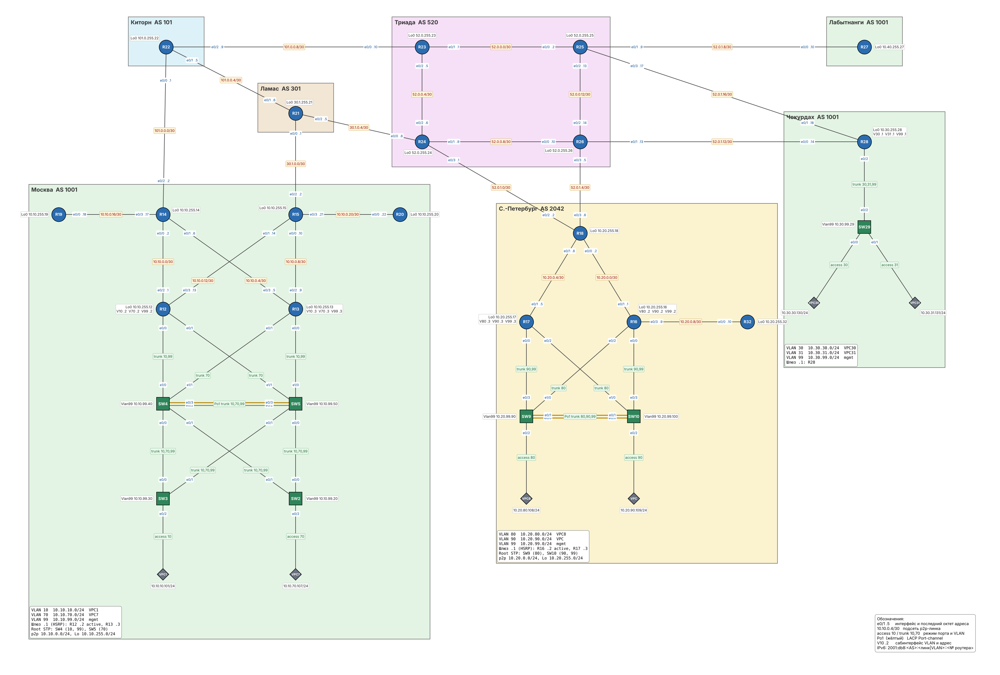

# MPLS. BGP free core

### Задание

Настроить в провайдере Триада MPLS так, чтобы внутренние (P) роутеры не держали маршруты BGP (BGP free core), а трафик между пограничными (PE) роутерами передавался по меткам.

### Решение

1. [Схема и роли](#1-схема-и-роли)
2. [Почему BGP free core работает](#2-почему-bgp-free-core-работает)
3. [MPLS и LDP](#3-mpls-и-ldp)
4. [iBGP между PE](#4-ibgp-между-pe)
5. [IPv6 через 6PE](#5-ipv6-через-6pe)
6. [Проверка](#6-проверка)
7. [Конфигурационные файлы](configs/)

Работа продолжает [лабу 12](../lab12/). Изменения затронули только Триаду (R23-R26). Файл стенда для EVE-NG: [lab13.unl](lab13.unl).

### 1. Схема и роли



| Роутер | Роль | Почему |
|---|---|---|
| R23 | P | только внутренние линки Триады (линк к Киторну в BGP не участвует) |
| R24 | PE | eBGP с Ламасом и С.-Петербургом |
| R25 | PE | подключены клиенты Чокурдах и Лабытнанги |
| R26 | PE | eBGP с С.-Петербургом, подключён Чокурдах |

| Что | Где |
|---|---|
| IGP | IS-IS из [лабы 04](../lab04/), без изменений |
| LDP | все линки между R23, R24, R25, R26 |
| iBGP | полная связность R24, R25, R26 по Loopback0 |
| BGP на R23 | удалён, вместе с route reflector из [лабы 07](../lab07/) |

### 2. Почему BGP free core работает

Без MPLS каждый роутер на пути пакета ищет адрес назначения в своей таблице маршрутизации. Если R23 не знает сеть Москвы `100.1.0.0/24`, пакет от R25 в Москву на нём будет отброшен. Поэтому раньше BGP работал на всех роутерах Триады.

С MPLS PE-роутер находит для внешнего префикса BGP next-hop (Loopback выходного PE, например `52.0.255.24`) и навешивает на пакет метку LDP, соответствующую этому Loopback. Дальше P-роутеры коммутируют пакет по метке и в IP-заголовок не смотрят. Им нужно знать только маршруты до Loopback PE, а это IS-IS. Предпоследний роутер снимает метку (PHP), и PE-выход получает обычный IP-пакет.

Что это даёт:
- P-роутеры не держат полную таблицу BGP: в реальной сети это сотни тысяч маршрутов, а здесь хватает нескольких десятков маршрутов IS-IS;
- iBGP нужен только между PE, ядро можно масштабировать без изменения BGP.

### 3. MPLS и LDP

На R23-R26:
```
mpls label protocol ldp
mpls ldp router-id Loopback0 force
!
interface Ethernet0/1
 mpls ip
!
interface Ethernet0/2
 mpls ip
```
LDP Router ID привязан к Loopback0: метки раздаются для `/32` адресов Loopback из IS-IS, и сессия LDP не зависит от состояния отдельного линка. MPLS включён только внутри Триады, на линках к клиентам и другим провайдерам его нет.

### 4. iBGP между PE

Route reflector на R23 больше нет, поэтому три PE связаны iBGP напрямую, каждый с каждым (3 сессии). На R25:
```
router bgp 520
 neighbor 52.0.255.24 remote-as 520
 neighbor 52.0.255.24 update-source Loopback0
 neighbor 52.0.255.26 remote-as 520
 neighbor 52.0.255.26 update-source Loopback0
 !
 address-family ipv4
  neighbor 52.0.255.24 activate
  neighbor 52.0.255.24 next-hop-self
  neighbor 52.0.255.26 activate
  neighbor 52.0.255.26 next-hop-self
 exit-address-family
```
`next-hop-self` здесь обязателен: next-hop внешнего маршрута должен быть Loopback PE, для которого у LDP есть метка. Адреса внешних соседей (например, линк к Ламасу) в IS-IS не анонсируются, и меток для них нет.

Политики из предыдущих работ (фильтры, приоритеты, балансировка на R18) не менялись: они настроены на роутерах офисов и других провайдеров.

### 5. IPv6 через 6PE

Ядро Триады тоже не знает внешних IPv6-префиксов. Чтобы не поднимать для IPv6 отдельный LDP, используется 6PE: IPv6-маршруты передаются между PE по той же IPv4-сессии iBGP вместе с меткой (`send-label`). Next-hop у них IPv4-адрес PE в виде `::FFFF:52.0.255.24`, и до него трафик идёт по IPv4 LSP. Пакет несёт две метки: внешнюю (LDP, до выходного PE) и внутреннюю (BGP, указывает выходному PE, что внутри IPv6).
```
ipv6 cef
!
router bgp 520
 address-family ipv6
  neighbor 52.0.255.24 activate
  neighbor 52.0.255.24 send-label
  neighbor 52.0.255.24 next-hop-self
```
Отдельные iBGP-сессии по IPv6 через route reflector из [лабы 09](../lab09/) удалены.

### 6. Проверка

#### LDP и ядро без BGP

R23 установил LDP-соседство с R24 и R25 (это все его внутренние линки), MPLS работает на обоих интерфейсах:
```
R23#show mpls ldp neighbor | include Peer LDP|State
    Peer LDP Ident: 52.0.255.24:0; Local LDP Ident 52.0.255.23:0
        State: Oper; Msgs sent/rcvd: 20/21; Downstream
    Peer LDP Ident: 52.0.255.25:0; Local LDP Ident 52.0.255.23:0
        State: Oper; Msgs sent/rcvd: 20/21; Downstream

R23#show mpls interfaces
Interface              IP            Tunnel   BGP Static Operational
Ethernet0/1            Yes (ldp)     No       No  No     Yes
Ethernet0/2            Yes (ldp)     No       No  No     Yes
```

На R23 работает только IS-IS, маршрута до Москвы у него нет:
```
R23#show ip protocols | include Routing Protocol
Routing Protocol is "application"
Routing Protocol is "isis TRIADA"

R23#show ip route 100.1.0.0
% Network not in table
```

Таблица меток R23 содержит только адреса Триады. Метки для Loopback соседних PE R23 снимает сам (`Pop Label`, PHP), а для R26 передаёт дальше. Счётчик `Bytes Label Switched` показывает, что через R23 уже прошёл транзитный трафик:
```
R23#show mpls forwarding-table
Local      Outgoing   Prefix           Bytes Label   Outgoing   Next Hop
Label      Label      or Tunnel Id     Switched      interface
16         Pop Label  52.0.255.25/32   1776          Et0/1      52.0.0.2
17         Pop Label  52.0.255.24/32   1629          Et0/2      52.0.0.6
18         18         52.0.255.26/32   0             Et0/1      52.0.0.2
           16         52.0.255.26/32   0             Et0/2      52.0.0.6
19         Pop Label  52.0.0.12/30     0             Et0/1      52.0.0.2
20         Pop Label  52.0.1.8/30      506           Et0/1      52.0.0.2
21         Pop Label  52.0.1.16/30     0             Et0/1      52.0.0.2
22         Pop Label  52.0.0.8/30      0             Et0/2      52.0.0.6
23         Pop Label  52.0.1.0/30      0             Et0/2      52.0.0.6
24         22         52.0.1.4/30      0             Et0/1      52.0.0.2
           20         52.0.1.4/30      0             Et0/2      52.0.0.6
25         23         52.0.1.12/30     0             Et0/1      52.0.0.2
           21         52.0.1.12/30     0             Et0/2      52.0.0.6
```

#### iBGP между PE

У R25 два iBGP-соседа, R24 и R26. Next-hop всех внешних маршрутов это Loopback выходного PE:
```
R25#show bgp ipv4 unicast summary
Neighbor        V           AS MsgRcvd MsgSent   TblVer  InQ OutQ Up/Down  State/PfxRcd
52.0.255.24     4          520      16       7        6    0    0 00:02:55        5
52.0.255.26     4          520      13       7        6    0    0 00:02:55        2

R25#show ip bgp
     Network          Next Hop            Metric LocPrf Weight Path
 *>i 20.42.0.0/24     52.0.255.26              0    100      0 2042 i
 * i                  52.0.255.24              0    100      0 2042 i
 *>i 30.1.0.0/16      52.0.255.24              0    100      0 301 i
 *>i 52.0.0.0/16      52.0.255.26              0    100      0 i
 * i                  52.0.255.24              0    100      0 i
 *>i 100.1.0.0/24     52.0.255.24              0    100      0 301 1001 i
 *>i 101.0.0.0/16     52.0.255.24              0    100      0 301 101 i
```

#### Передача по меткам

R25 отправляет трафик в Москву через R24 с меткой LDP для `52.0.255.24`. Путей два одинаковой стоимости: через P-роутер R23 (метка 17) и через R26 (метка 18):
```
R25#show ip cef 100.1.0.0 detail
100.1.0.0/24, epoch 0, flags [rib only nolabel, rib defined all labels]
  recursive via 52.0.255.24
    nexthop 52.0.0.1 Ethernet0/0 label 17
    nexthop 52.0.0.14 Ethernet0/2 label 18
```

В трассировке на первом хопе видна метка: R23 (`52.0.0.1`) и R26 (`52.0.0.14`) коммутируют пакет по метке, не зная маршрута до `100.1.0.0/24`. Второй хоп R24 получает пакет уже без метки и отправляет его Ламасу:
```
R25#traceroute 100.1.0.15 source Loopback0 numeric
Tracing the route to 100.1.0.15
  1 52.0.0.1 [MPLS: Label 17 Exp 0] 0 msec
    52.0.0.14 [MPLS: Label 18 Exp 0] 0 msec
    52.0.0.1 [MPLS: Label 17 Exp 0] 1 msec
  2 52.0.0.9 0 msec
    52.0.0.6 0 msec
    52.0.0.9 1 msec
  3 30.1.0.5 [AS 301] 0 msec 1 msec 0 msec
  4 30.1.0.2 [AS 301] 0 msec *  2 msec
```

#### 6PE

IPv6-префиксы приходят на R25 по IPv4-сессии, next-hop в виде IPv4-адреса PE:
```
R25#show bgp ipv6 unicast
     Network          Next Hop            Metric LocPrf Weight Path
 *>i 2001:DB8:101::/48
                       ::FFFF:52.0.255.24
                                                0    100      0 301 101 i
 *>i 2001:DB8:301::/48
                       ::FFFF:52.0.255.24
                                                0    100      0 301 i
 * i 2001:DB8:520::/48
                       ::FFFF:52.0.255.24
                                                0    100      0 i
 *>i                  ::FFFF:52.0.255.26
                                                0    100      0 i
 *>i 2001:DB8:1001::/48
                       ::FFFF:52.0.255.24
                                                0    100      0 301 1001 i
 * i 2001:DB8:2042::/48
                       ::FFFF:52.0.255.24
                                          1024640    100      0 2042 i
 *>i                  ::FFFF:52.0.255.26
                                          1024640    100      0 2042 i

R25#show ipv6 route 2001:db8:1001::/48
Routing entry for 2001:DB8:1001::/48
  Known via "bgp 520", distance 200, metric 0, type internal
  Route count is 1/1, share count 0
  Routing paths:
    52.0.255.24%default indirectly connected
      MPLS label: 29
```

Метку 29 R24 выделил для префикса Москвы, а R26 для своих префиксов использует свои метки:
```
R24#show bgp ipv6 unicast labels
   Network          Next Hop      In label/Out label
   2001:DB8:101::/48
                    2001:DB8:301:2124::21
                                    27/nolabel
   2001:DB8:301::/48
                    2001:DB8:301:2124::21
                                    28/nolabel
   2001:DB8:520::/48
                    ::FFFF:52.0.255.26
                                    25/25
                    ::              25/nolabel
   2001:DB8:1001::/48
                    2001:DB8:301:2124::21
                                    29/nolabel
   2001:DB8:2042::/48
                    ::FFFF:52.0.255.26
                                    26/26
                    2001:DB8:520:1824::18
                                    26/nolabel
```

В трассировке IPv6 на первом хопе две метки: 17 (LDP, до R24) и 29 (BGP, префикс Москвы на R24). Ядро передаёт IPv6-пакет, не имея IPv6-маршрута до Москвы:
```
R25#traceroute ipv6 2001:db8:1001:ffff::15
Tracing the route to 2001:DB8:1001:FFFF::15

  1 ::FFFF:52.0.0.1 [MPLS: Labels 17/29 Exp 0] 18 msec
    ::FFFF:52.0.0.14 1 msec
    ::FFFF:52.0.0.1 0 msec
  2 2001:DB8:301:2124::24 [AS 301] [MPLS: Label 29 Exp 0] 1 msec 0 msec 1 msec
  3 2001:DB8:301:2124::21 [AS 301] 0 msec 0 msec 0 msec
  4 2001:DB8:301:1521::15 [AS 301] 0 msec 1 msec 0 msec
```

#### Политики других работ сохранились

Балансировка С.-Петербурга по двум линкам в Триаду ([лаба 07](../lab07/)) работает и без route reflector: R26 получает маршруты от R24 по прямой iBGP-сессии.
```
R18#show ip route 100.1.0.0
Routing entry for 100.1.0.0/24
  Known via "bgp 2042", distance 20, metric 0
  Tag 520, type external
  Last update from 52.0.1.1 00:01:11 ago
  Routing Descriptor Blocks:
  * 52.0.1.5, from 52.0.1.5, 00:01:11 ago
      Route metric is 0, traffic share count is 1
      AS Hops 3
      Route tag 520
    52.0.1.1, from 52.0.1.1, 00:01:11 ago
      Route metric is 0, traffic share count is 1
      AS Hops 3
      Route tag 520
```

#### VPN из лабы 12 поверх нового ядра

Туннели GRE и DMVPN с IPSec идут через Триаду, и после перевода ядра на MPLS они работают как раньше (сертификаты на стенде выпущены заново, см. [лабу 12](../lab12/#5-выпуск-сертификатов)):
```
R18#show crypto session
Interface: Tunnel0
Profile: IKEV2-PROF
Session status: UP-ACTIVE
Peer: 100.1.0.15 port 500
  IKEv2 SA: local 20.42.0.18/500 remote 100.1.0.15/500 Active
  IPSEC FLOW: permit 47 host 20.42.0.18 host 100.1.0.15
        Active SAs: 2, origin: crypto map

R14#show dmvpn
Interface: Tunnel1, IPv4 NHRP Details
Type:Hub, NHRP Peers:2,

 # Ent  Peer NBMA Addr Peer Tunnel Add State  UpDn Tm Attrb
 ----- --------------- --------------- ----- -------- -----
     1 52.0.1.10           10.200.0.27    UP 00:01:46     D
     1 52.0.1.14           10.200.0.28    UP 00:01:21     D

VPC1> ping 10.20.80.108 -c 3
84 bytes from 10.20.80.108 icmp_seq=1 ttl=60 time=4.389 ms
84 bytes from 10.20.80.108 icmp_seq=2 ttl=60 time=1.949 ms
84 bytes from 10.20.80.108 icmp_seq=3 ttl=60 time=2.018 ms

VPC30> ping 10.10.255.12 -c 3
84 bytes from 10.10.255.12 icmp_seq=1 ttl=253 time=1.478 ms
84 bytes from 10.10.255.12 icmp_seq=2 ttl=253 time=2.218 ms
84 bytes from 10.10.255.12 icmp_seq=3 ttl=253 time=1.415 ms
```
