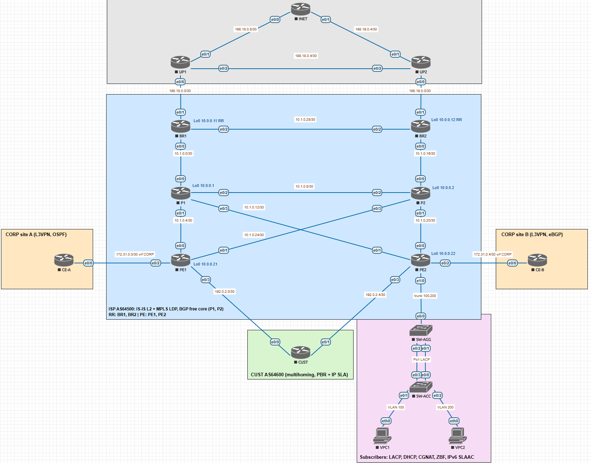
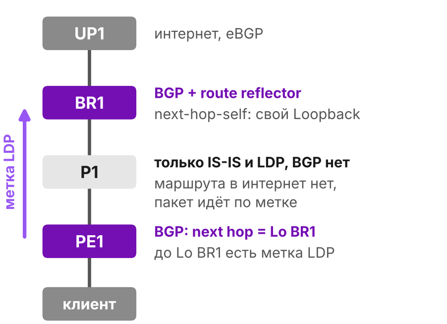
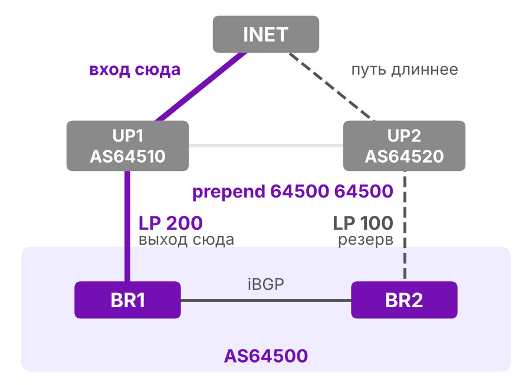
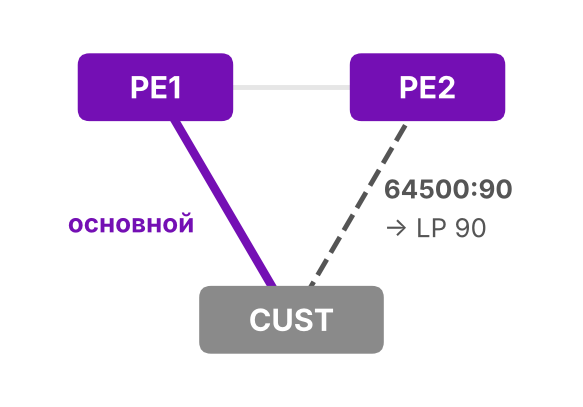
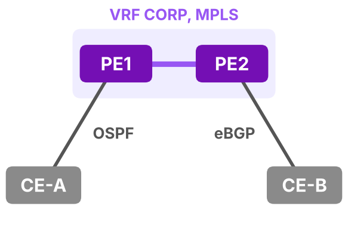
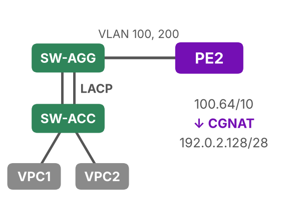
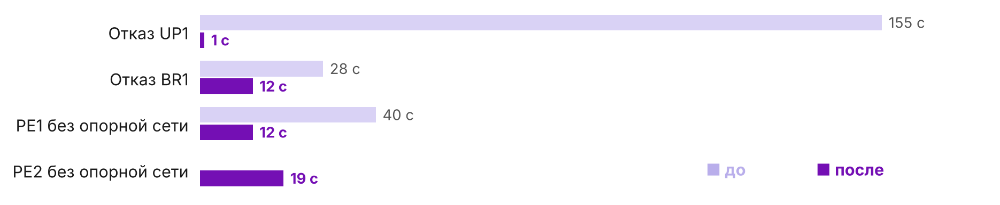
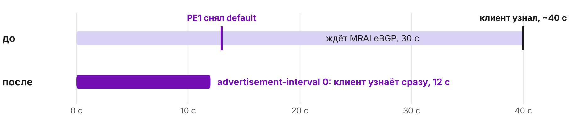

# Проектная работа. Организация сети интернет-сервис-провайдера

### О чём проект

Я собрал в EVE-NG модель небольшого регионального провайдера. У провайдера своя автономная система AS64500 и свои адреса: 192.0.2.0/24 и `2001:db8:100::/48`. В интернет он ходит через двух вышестоящих операторов, UP1 (AS64510) и UP2 (AS64520).

Клиенты у провайдера трёх видов:

* домашние абоненты. Их два VLAN, адреса серые (CGNAT), IPv4 они получают по DHCP, IPv6 по SLAAC;
* корпоративный клиент CORP с двумя офисами. Офисы связаны между собой через сеть провайдера по MPLS L3VPN;
* клиент CUST со своей AS64600. Он подключён сразу к двум PE и сам решает, какой канал у него основной.

Внутри провайдера работают IS-IS и MPLS. Ядро (P1 и P2) сделано без BGP: P-роутеры знают только IS-IS и метки, а BGP настроен только на краях сети, на BR и PE.

### Цель и задачи

**Цель:** собрать работающую модель сети провайдера и проверить, как она ведёт себя не только в обычном режиме, но и при отказах.

**Что нужно было сделать:**

1. Нарисовать топологию, раздать адреса IPv4/IPv6 и решить, какой узел за что отвечает.
2. Поднять опорную сеть: IS-IS, MPLS LDP, iBGP через route reflector, ядро без BGP.
3. Подключить двух апстримов и настроить, через кого трафик входит и выходит.
4. Подключить клиентов: CUST к двум PE, VPN для CORP, домашних абонентов.
5. Настроить DHCP, CGNAT, зональный файрвол, NTP и AAA.
6. Проверить всё в работе и на отказах и записать, что получилось.

### Содержание

1. [Схема](#1-схема)
2. [Роли и адресация](#2-роли-и-адресация)
3. [Технологии](#3-технологии)
4. [Опорная сеть](#4-опорная-сеть)
5. [Апстримы](#5-апстримы)
6. [Клиент AS64600](#6-клиент-as64600)
7. [Корпоративный клиент](#7-корпоративный-клиент)
8. [Домашние абоненты](#8-домашние-абоненты)
9. [Отказы](#9-отказы)
10. [NTP и AAA](#10-ntp-и-aaa)
11. [Проблемы, на которые наткнулся](#11-проблемы-на-которые-наткнулся)
12. [Выводы](#12-выводы)

Файлы: [стенд EVE-NG](project_isp.unl), [конфиги всех узлов](configs/).

### 1. Схема



Всего 16 узлов: 12 роутеров IOL 15.4, 2 коммутатора IOL L2 и 2 VPCS.

### 2. Роли и адресация

| Узел | Что делает | Loopback0 |
|---|---|---|
| BR1, BR2 | граница с апстримами, они же route reflector'ы | 10.0.0.11, 10.0.0.12 |
| P1, P2 | ядро: только IS-IS и LDP, BGP нет | 10.0.0.1, 10.0.0.2 |
| PE1, PE2 | к ним подключены клиенты; VRF CORP; на PE2 ещё абоненты | 10.0.0.21, 10.0.0.22 |
| UP1, UP2, INET | «интернет»: два апстрима и внешняя сеть 198.51.100.0/24 | |
| CUST | клиент AS64600, 203.0.113.0/24, `2001:db8:600::/48` | |
| CE-A, CE-B | офисы CORP, сети 172.16.1.0/24 и 172.16.2.0/24 | |
| SW-AGG, SW-ACC | коммутаторы абонентов (агрегация и доступ) | |
| VPC1, VPC2 | абоненты в VLAN 100 и VLAN 200 | |

| Сеть | Для чего |
|---|---|
| 10.0.0.0/24 | Loopback0 роутеров провайдера |
| 10.1.0.0/24 | линки внутри сети провайдера, по /30 |
| 192.0.2.0/24 | свой блок провайдера: 192.0.2.0/30 и .4/30 стыки с CUST, 192.0.2.128/28 пул CGNAT |
| `2001:db8:100::/48` | свой IPv6: `2001:db8:100:100::/64` и `2001:db8:100:200::/64` абоненты, `2001:db8:100:f001::/64` и `2001:db8:100:f002::/64` стыки с CUST, `2001:db8:100:ffff::/64` loopback |
| 100.64.100.0/24, 100.64.200.0/24 | серые адреса абонентов (RFC 6598) |
| 172.31.0.0/30, 172.31.0.4/30 | стыки PE-CE в VRF CORP |
| 198.18.0.0/30, 198.19.0.0/30 | стыки BR1-UP1 и BR2-UP2 |
| 198.18.0.4/30, 198.18.0.8/30, 198.19.0.4/30 | внутри «интернета»: UP1-UP2, UP1-INET, UP2-INET |

Все адреса взяты из диапазонов для документации, чтобы стенд не пересекался с реальными сетями.

### 3. Технологии

| # | Технология | Где | Урок курса |
|---|---|---|---|
| 1 | VLAN, 802.1Q, trunk, router-on-a-stick | SW-AGG, SW-ACC, PE2 | [lab01](../lab01/) |
| 2 | Rapid PVST+, выбор корня | корень на SW-AGG | [lab01](../lab01/) |
| 3 | LACP (EtherChannel) | Po1 между SW-AGG и SW-ACC | [lab01](../lab01/) |
| 4 | PBR + IP SLA + track | CUST | [lab02](../lab02/) |
| 5 | OSPF | PE1 - CE-A в VRF CORP | [lab03](../lab03/) |
| 6 | IS-IS L2, wide metrics | сеть провайдера | [lab04](../lab04/) |
| 7 | eBGP, multihoming | BR1/BR2 с апстримами, PE1/PE2 с CUST | [lab06](../lab06/) |
| 8 | iBGP, два route reflector'а | BR1, BR2 | [lab07](../lab07/) |
| 9 | local preference, AS-path prepend, communities | BR1, BR2, PE1, PE2, CUST | [lab07](../lab07/), [lab08](../lab08/) |
| 10 | фильтры BGP: bogon, prefix-list, maximum-prefix, экспорт по community | BR, PE | [lab08](../lab08/) |
| 11 | BGP для IPv6 | с апстримами и CUST | [lab09](../lab09/) |
| 12 | DHCP-сервер | PE2 | [lab10](../lab10/) |
| 13 | NAT (CGNAT, PAT в пул) | PE2 | [lab10](../lab10/) |
| 14 | NTP: master, peer, клиенты | BR1, BR2, P, PE | [lab10](../lab10/) |
| 15 | MPLS LDP | сеть провайдера | [lab13](../lab13/) |
| 16 | ядро без BGP (BGP free core) | P1, P2 | [lab13](../lab13/) |
| 17 | 6PE (send-label) | BR, PE | [lab13](../lab13/) |
| 18 | MPLS L3VPN, VRF, VPNv4, PE-CE по OSPF и eBGP | PE1, PE2, CE-A, CE-B | |
| 19 | IPv6 SLAAC | PE2, абоненты | |
| 20 | Zone-Based Firewall | PE2 | |
| 21 | AAA (local) | все роутеры | |
| 22 | BFD для eBGP и IS-IS | BR, UP, P, PE | |

### 4. Опорная сеть

Сеть провайдера это BR, P и PE. На всех линках между ними IS-IS level-2 в режиме point-to-point и LDP, router-id LDP берётся с Loopback0. Ядро это только P1 и P2. Каждый PE подключён к обоим P, P1 и P2 соединены между собой, BR1 и BR2 тоже, так что один упавший линк или узел сеть не рвёт.

BGP есть только на BR и PE. BR1 и BR2 работают route reflector'ами, PE их клиенты. На BR и PE стоит `next-hop-self`: вместо адреса апстрима или клиента next hop становится loopback'ом роутера. RR next hop не трогает, поэтому, например, маршрут клиента, который пришёл на PE1, на PE2 виден с next hop 10.0.0.21 (это loopback PE1, вывод в разделе 6). В итоге next hop всегда чей-то loopback, а до каждого loopback есть метка LDP. P пересылает пакет по метке, и маршруты интернета ему не нужны.



На всех линках сети провайдера включён BFD (300 мс, 3 пропуска), IS-IS к нему привязан через `bfd all-interfaces`. Зачем он понадобился, видно в разделе 9.

```
BR1#show isis neighbors
P1             L2   Et0/0       10.1.0.1        UP    28       00
BR2            L2   Et0/2       10.1.0.30       UP    27       01

BR1#show bgp ipv4 unicast summary | begin Neighbor
10.0.0.12       4        64500      28      28        8    0    0 00:08:46        3
10.0.0.21       4        64500      18      31        8    0    0 00:08:50        1
10.0.0.22       4        64500      18      31        8    0    0 00:08:08        1
198.18.0.1      4        64510      18      13        8    0    0 00:08:12        3

P1#show ip route 198.51.100.0
% Network not in table

P1#show mpls forwarding-table
16         Pop Label  10.0.0.21/32     5193          Et0/1      10.1.0.6
21         Pop Label  10.0.0.11/32     10038         Et0/0      10.1.0.2
24         Pop Label  10.0.0.22/32     7465          Et0/3      10.1.0.14
```

Маршрута в 198.51.100.0 у P1 нет, а трафик через него при этом идёт: это видно по байтам в таблице меток.

IPv6 через ядро идёт по 6PE. Сессии IPv6 поднимаются между IPv4-loopback'ами с `send-label`, и BGP вешает метку на каждый IPv6-префикс:

```
PE2#show bgp ipv6 unicast labels
   Network          Next Hop      In label/Out label
   2001:DB8:100:100::/64
                    ::              27/nolabel
   2001:DB8:999::/48
                    ::FFFF:10.0.0.11
                                    nolabel/30
```

`::FFFF:10.0.0.11` это IPv4-адрес BR1, записанный в формате IPv6. IPv6-пакет уходит в ядро с двумя метками: снаружи метка LDP до BR1, внутри метка BGP.

### 5. Апстримы

| Что нужно | Как сделано |
|---|---|
| Исходящий трафик через UP1 | на BR1 local-preference 200 для маршрутов от UP1, на BR2 100 |
| Входящий трафик тоже через UP1 | BR2 в анонсах к UP2 добавляет `as-path prepend 64500 64500` |
| Отличать свои маршруты от чужих | от апстримов ставится community 64500:200, от клиентов 64500:100 |
| Что анонсируем наружу | только свой /24 (prefix-list PL-OWN) и маршруты с community 64500:100 |
| Что принимаем | без bogon, без своих и клиентских сетей, не длиннее /24, maximum-prefix 1000 |
| Чтобы не утёк пул CGNAT | 192.0.2.128/28 наружу не анонсируется, только /24 целиком |
| Быстро замечать отказ стыка | BFD 300 мс x 3 на BR1-UP1 и BR2-UP2, `neighbor ... fall-over bfd` для IPv4 и IPv6 |



```
BR1#show bgp ipv4 unicast neighbors 198.18.0.1 advertised-routes
 *>  192.0.2.0        0.0.0.0                  0         32768 i
 *>i 203.0.113.0      10.0.0.21                0    100      0 64600 i

UP2#show bgp ipv4 unicast 192.0.2.0
Paths: (3 available, best #2, table default)
  64999 64510 64500
    198.19.0.6 from 198.19.0.6 (198.51.100.1)
      Origin IGP, localpref 100, valid, external
  64510 64500
    198.18.0.5 from 198.18.0.5 (198.18.255.1)
      Origin IGP, localpref 100, valid, external, best
  64500 64500 64500
    198.19.0.2 from 198.19.0.2 (10.0.0.12)
      Origin IGP, metric 0, localpref 100, valid, external
```

Напрямую от BR2 путь к 192.0.2.0/24 получается длиннее из-за prepend, поэтому UP2 выбирает путь через UP1. Значит, и входящий трафик идёт через основной канал.

### 6. Клиент AS64600

CUST подключён к PE1 (основной канал) и PE2 (резерв). Какой канал резервный, решает сам клиент: в анонсе к PE2 он ставит community 64500:90, а PE2, увидев её, ставит этому маршруту local-preference 90. Клиент отдаёт обоим PE только свой /24. Провайдер отдаёт клиенту только default (`prefix-list PL-NONE out`), на входе стоит maximum-prefix 10. У себя клиент ставит local-preference 200 на default от PE1, так что и наружу он ходит через основной канал.



Default отдаётся не всегда, а по условию: `default-originate route-map RM-DEFAULT-COND`. PE анонсирует его, только пока у него самого в таблице есть контрольный префикс 198.51.100.0/24 (для IPv6 `2001:db8:999::/48`). Зачем это нужно: если PE потеряет связь с остальной сетью, а сессия с клиентом останется живой, без условия клиент так и слал бы трафик в изолированный PE1 (у него же LP 200). С условием PE снимает default, и клиент уходит на второй PE. На стенде контрольный префикс это сеть INET. В настоящей сети я бы проверял default от BR или несколько стабильных префиксов.

Ещё на сессиях с клиентом стоит `advertisement-interval 0`. По умолчанию eBGP шлёт обновления соседу не чаще раза в 30 секунд, и на стенде из-за этого отзыв default приходил к клиенту с опозданием. Подробно в разделе 9.

```
PE2#show bgp ipv4 unicast 203.0.113.0
  64600
    10.0.0.21 (metric 20) from 10.0.0.11 (10.0.0.11)
      Origin IGP, metric 0, localpref 100, valid, internal, best
      Community: 64500:100
  64600
    192.0.2.6 from 192.0.2.6 (203.0.113.1)
      Origin IGP, metric 0, localpref 90, valid, external
      Community: 64500:90 64500:100

CUST#show ip bgp
 *   0.0.0.0          192.0.2.5                              0 64500 i
 *>                   192.0.2.1                     200      0 64500 i
```

Видно, что даже PE2, у которого есть прямой линк к клиенту, шлёт трафик клиенту через PE1. Если основной канал упадёт, в работу пойдёт маршрут с LP 90.

Внутри у клиента две сети, и PBR разводит их по разным каналам. LAN1 203.0.113.0/25 ходит по BGP через PE1. LAN2 203.0.113.128/25 ходит через PE2, пока через PE2 доступен интернет.

IP SLA пингует не сам PE2, а узел 198.51.100.1 за ним. Маршрут /32 заставляет зонд идти именно через PE2. Так SLA упадёт и в том случае, когда линк до PE2 жив, а сам PE2 потерял выход наружу. Минус такого решения: весь трафик самого CUST к 198.51.100.1 тоже идёт через PE2. И ещё: зонд проверяет путь в обе стороны, поэтому при отказах на обратном пути track тоже ненадолго падает, это видно в разделе 9.

Сети клиента на стенде сделаны loopback'ами, поэтому политика висит на `ip local policy`. Для настоящей LAN это был бы `ip policy route-map` на её интерфейсе.

```
ip route 198.51.100.1 255.255.255.255 192.0.2.5 name SLA-PROBE-VIA-PE2
ip sla 1
 icmp-echo 198.51.100.1 source-interface Loopback2
 frequency 5
track 1 ip sla 1 reachability
 delay down 10 up 10
route-map RM-PBR-LAN2 permit 10
 match ip address ACL-LAN2
 set ip next-hop verify-availability 192.0.2.5 1 track 1
```

```
CUST#traceroute 198.51.100.53 source Loopback2      CUST#traceroute 198.51.100.53 source Loopback1
  1 192.0.2.5                                          1 192.0.2.1
  2  *                                                 2  *
  3 10.1.0.2                                           3 10.1.0.2
  4 198.18.0.1                                         4 198.18.0.1
  5 198.18.0.10                                        5 198.18.0.10
```

Звёздочка на втором хопе это P1. TTL кончается на нём, когда у пакета одна метка (IPv4 поверх LDP). В этом случае IOS отправляет ICMP time exceeded по своей таблице маршрутов, а маршрута к 203.0.113.0/24 у P нет, и ответ теряется. Для ядра без BGP это нормально. Если меток две, как в L3VPN, P отправляет ICMP дальше по LSP, и звёздочки нет.

### 7. Корпоративный клиент

Для CORP на PE1 и PE2 создан VRF CORP, RD и RT 64500:10. Маршруты VPNv4 ходят через те же route reflector'ы. Офисы подключены по-разному:

* офис A: OSPF между PE1 и CE-A, на PE1 маршруты OSPF и BGP переносятся друг в друга;
* офис B: eBGP между PE2 и CE-B (AS65001).



```
PE2#show bgp vpnv4 unicast all
Route Distinguisher: 64500:10 (default for vrf CORP)
 *>i 172.16.1.0/24    10.0.0.21               11    100      0 ?
 *>  172.16.2.0/24    172.31.0.6               0             0 65001 i

CE-A#show ip route ospf
O E2     172.16.2.0/24 [110/1] via 172.31.0.1, Ethernet0/0

CE-A#ping 172.16.2.1 source Loopback1
!!!
Success rate is 100 percent (3/3)
```

Сети CORP живут только в VRF. В обычной таблице PE и в интернете их нет:

```
PE1#show ip route 172.16.2.0
% Network not in table
PE1#show ip route vrf CORP 172.16.2.0 | include from|via
  * 10.0.0.22 (default), from 10.0.0.11, 00:10:53 ago

INET#show ip route 172.16.0.0
% Network not in table
```

### 8. Домашние абоненты

Абоненты сидят за двумя коммутаторами. SW-ACC (доступ) соединён с SW-AGG (агрегация) двумя линками, собранными в LACP Po1. SW-AGG подключён транком к PE2, а PE2 принимает VLAN 100 и 200 на сабинтерфейсах.



```
SW-AGG#show etherchannel summary
1      Po1(SU)         LACP      Et0/1(P)    Et0/2(P)

SW-AGG#show spanning-tree vlan 100
             This bridge is the root
SW-ACC#show spanning-tree vlan 100
Po1                 Root FWD 56        128.65   Shr
```

**DHCP и CGNAT.** PE2 раздаёт адреса из 100.64.100.0/24 и 100.64.200.0/24 (это диапазон 100.64.0.0/10 из RFC 6598) и транслирует их в пул 192.0.2.129-142 с PAT:

```
VPC1> ip dhcp
DDORA IP 100.64.100.10/24 GW 100.64.100.1
VPC1> ping 198.51.100.53
84 bytes from 198.51.100.53 icmp_seq=1 ttl=251 time=1.601 ms

PE2#show ip nat translations
icmp 192.0.2.130:37614 100.64.100.10:37614 198.51.100.53:37614 198.51.100.53:37614
```

**Зональный файрвол.** Зон две: SUBSCRIBERS (сабинтерфейсы абонентов) и OUTSIDE (всё остальное: сеть провайдера, клиенты, VPN). Из абонентов наружу пропускаются TCP, UDP и ICMP (IPv4) с инспекцией, остальное отбрасывается. Ответы пускаются обратно по открытым сессиям:

```
PE2#show policy-map type inspect zone-pair sessions
  Session C26CC700 (100.64.100.10:8)=>(198.51.100.53:0) icmp SIS_OPEN
```

Проверил и TCP через файрвол и CGNAT: VPC1 открывает соединение на порт 23 INET.

```
VPC1> ping 198.51.100.53 -P 6 -p 23 -c 2
Connect   23@198.51.100.53 seq=1 ttl=251 time=2.615 ms
SendData  23@198.51.100.53 seq=1 ttl=251 time=1.122 ms
```

UDP отдельно не проверял: на INET нет UDP-сервиса, который бы ответил.

Снаружи к абоненту по IPv4 не попасть уже из-за CGNAT: адрес из пула без трансляции ведёт в Null0, и PE2 отвечает unreachable:

```
INET#ping 192.0.2.130
U.
Success rate is 0 percent (0/2)
```

**IPv6.** Абоненты сами получают адрес по SLAAC из `2001:db8:100:100::/64` и `2001:db8:100:200::/64`. Тут вылезла особенность IOS 15.4: зональный файрвол не инспектирует ICMPv6 (`match protocol icmp` работает только для IPv4). Поэтому для ICMPv6 я сделал отдельные классы с действием pass по IPv6 ACL: наружу можно echo-request, внутрь только echo-reply и служебные ошибки. Pass не помнит состояние, поэтому правила пришлось писать в обе стороны. NAT для IPv6 нет, так что входящее соединение к абоненту режет именно файрвол:

```
VPC1> show ipv6
GLOBAL SCOPE      : 2001:db8:100:100:2050:79ff:fe66:680e/64
VPC1> ping 2001:db8:999::1
2001:db8:999::1 icmp6_seq=1 ttl=60 time=1.354 ms

INET#ping 2001:db8:100:100:2050:79ff:fe66:680e
..
Success rate is 0 percent (0/2)
```

### 9. Отказы

**Как мерил.** На CUST перед отказом запускал два зонда IP SLA: раз в секунду пинг 198.51.100.53 с Loopback1 (LAN1, ходит по BGP) и с Loopback2 (LAN2, ходит по PBR), таймаут 900 мс. Статистику снимал до отказа, после отказа и после восстановления. Сколько зондов не прошло между снимками, столько примерно секунд и длился перерыв, точность около секунды. Когда именно переключились роутеры, смотрел по логам и по `Last update ... ago` в таблице маршрутов.

Цифры «до исправления» я получил раньше и по-другому: обычным пингом с CUST, который запускал через 1-2 секунды после отключения. Начало отказа в них не попало, поэтому они примерные, и сравнивать их с «после» можно только по порядку величины.

| Сценарий | Что отключал | До исправления | После, LAN1 / LAN2 |
|---|---|---|---|
| 1. Упал основной апстрим | BR1 e0/1 | около 155 с | с BFD на стыках: 1 с / 1 с |
| 2. Упал BR1 целиком (граница и RR) | BR1 e0/0-2 | около 28 с | с BFD внутри сети: 11 с / 12 с |
| 3. PE1 потерял сеть провайдера, сессия с CUST жива | PE1 e0/0-1 | без условного default не прогонял: по конфигу трафик терялся бы, пока жива сессия; с условным default, но без `advertisement-interval 0`: 40 с / 11 с | 12 с / 11 с |
| 4. PE2 потерял сеть провайдера, стык с CUST жив | PE2 e0/0-1 | | 0 с / 19 с |

Когда я включал интерфейсы обратно, ни в одном из четырёх сценариев зонды не потеряли ни пакета. Перерыв короче секунды мог проскочить между зондами.



**Сценарий 1.** Исходящий трафик переключился сразу: BR1 потерял сессию с UP1, отозвал маршруты, и PE пошли через BR2. Долго ждал входящий. В EVE, если сделать `shutdown` на BR1, на стороне UP1 линк остаётся поднятым. UP1 отказа не видит и держит сессию до hold timer (180 с), а пока UP1 и INET не переключатся на путь через UP2, ответы уходят в никуда. В реальной сети так же выглядит отказ, когда между роутерами стоит коммутатор или транспорт. BFD с интервалом 300 мс и тремя пропусками замечает такое меньше чем за секунду и сразу рвёт BGP-сессию.

```
CUST#ping 198.51.100.53 source Loopback1 repeat 500 timeout 1     (без BFD)
............
*Nov 19 17:30:01.999: %TRACK-6-STATE: 1 ip sla 1 reachability Up -> Down..........
...
Success rate is 69 percent (345/500)
```

**Сценарий 2.** BR1 одновременно и граница с UP1, и один из RR. Входящий трафик переключился за 1,5 секунды, тут помог BFD с UP1. Исходящий ждал, пока loopback BR1 пропадёт из IS-IS. Без BFD внутри сети P1 заметил потерю соседа только по hold time. Как это шло по времени, по логам и таблицам маршрутов:

```
BR1  17:43:29.870  shutdown
P1   17:43:51.900  %CLNS-5-ADJCHANGE: ISIS: Adjacency to BR1 (Ethernet0/0) Down, hold time expired
PE1  17:44:00      маршрут 198.51.100.0/24 переключился на next hop 10.0.0.12
```

С BFD вышло 11-12 секунд. Остаток, как я предполагаю, уходит на задержки по умолчанию: пересчёт SPF в IS-IS и next-hop tracking в BGP. По отдельности я их не мерил, так что это пока гипотеза.

Сессия PE1 с выключенным BR1 при этом ещё до трёх минут висела в Established (hold timer), но трафику это не мешало: те же маршруты пришли через второй RR, BR2. Когда BR1 вернулся, его сессия с PE2 один раз сбросилась по hold timer и поднялась заново, на трафик это тоже не повлияло.

**Сценарий 3.** Ровно тот случай, ради которого делался условный default: PE потерял выход наружу, а сессия с клиентом жива. Сессия с PE1 осталась Established, но default от PE1 пропал и для IPv4, и для IPv6, у клиента остался только default от PE2:

```
CUST#show ip bgp | begin Network
 *>  0.0.0.0          192.0.2.5                              0 64500 i
 *>  203.0.113.0      0.0.0.0                  0         32768 i
CUST#show bgp ipv6 unicast | begin Network
 *>  ::/0             2001:DB8:100:F002::1
                                                              0 64500 i
CUST#show bgp ipv4 unicast neighbors 192.0.2.1 | include BGP state
  BGP state = Established, up for 07:35:56
```

Первый замер дал 40 секунд для LAN1. При этом PE1 терял маршрут 198.51.100.0 и переставал отдавать default уже в первые 13 секунд. Чтобы понять, куда уходит время, я во время отказа опрашивал PE1 и CUST каждые 10 секунд. Оказалось, что отзыв default доходил до клиента ещё примерно через 30 секунд (с точностью опроса 10 секунд). Сначала попробовал `bgp scan-time 5`, это ничего не дало, и я его убрал. А после `neighbor ... advertisement-interval 0` на сессиях с клиентом перерыв на этом стенде сократился с 40 до 12 секунд. Это сходится с задержкой отправки BGP UPDATE: у eBGP в IOS по умолчанию обновления соседу уходят не чаще раза в 30 секунд (MRAI, RFC 4271, раздел 9.2.1.1). Входящий трафик PE2 тоже повёл прямо к клиенту по резервному маршруту с LP 90.



**Сценарий 4.** Проверял PBR и IP SLA: PE2 отрезан от сети провайдера, стык с CUST поднят. LAN1 ходит через PE1 и отказа не заметил. У LAN2 зонд к 198.51.100.1 через PE2 перестал проходить, track ушёл в Down, и LAN2 пошёл по BGP через PE1:

```
PE2  00:52:46  shutdown e0/0-1 (LDP-соседи PE2 упали)
CUST 00:53:05  %TRACK-6-STATE: 1 ip sla 1 reachability Up -> Down

CUST#traceroute 198.51.100.53 source Loopback2      (до отказа)
  1 192.0.2.5
  ...
CUST#traceroute 198.51.100.53 source Loopback2      (PE2 изолирован)
  1 192.0.2.1
  2  *
  3 10.1.0.2
  4 198.18.0.1
  5 198.18.0.10
CUST#show bgp ipv4 unicast neighbors 192.0.2.5 | include BGP state
  BGP state = Established, up for 07:23:05
```

19 секунд для LAN2 это настройки SLA и track: зонд раз в 5 секунд, таймаут 5 секунд и `delay down 10`. Их можно уменьшить, но тогда track будет дёргаться от случайных потерь. Когда PE2 вернулся, track поднялся, и LAN2 снова пошёл через 192.0.2.5.

### 10. NTP и AAA

NTP: на BR1 `ntp master 3`, на BR2 `ntp master 4`, BR1 и BR2 peer друг другу. P и PE берут время с обоих (BR1 prefer), источник Loopback0.

AAA: `aaa new-model`. На консоли вход без пароля (список CONSOLE none, на стенде так удобнее), на VTY локальная база (список VTY local) и авторизация exec.

```
BR1#show ntp associations
*~127.127.1.1     .LOCL.           2     11     16   377
 ~10.0.0.12       127.127.1.1      4     60     64   376
```

### 11. Проблемы, на которые наткнулся

| Проблема | Что сделал |
|---|---|
| IOL L3 не умеет Port-channel: PE2 не принял Po1 вместе с сабинтерфейсами | LACP перенёс между коммутаторами, для этого добавил SW-AGG |
| Зональный файрвол в IOS 15.4 не инспектирует ICMPv6, IPv6-пинг абонентов отбрасывался | отдельные классы с pass по IPv6 ACL и обратная zone-pair OUTSIDE->SUBSCRIBERS |
| Loopback INET 198.51.100.53/32 пересекался с /24 на другом loopback | Lo1 сделал /32, а /24 анонсирую через Null0 |
| IOL при первом запуске висит в initial configuration dialog | на консоли каждого узла ответить no |
| В traceroute через ядро на P звёздочка | для ядра без BGP так и должно быть, объяснение в разделе 6 |
| Клиент мог слать трафик в PE, который потерял сеть провайдера (замечание ревью) | условный default-originate, раздел 6 |
| IP SLA проверял только соседний PE2 (замечание ревью) | зонд к узлу в интернете через PE2 |
| При отказе апстрима входящий трафик возвращался 2,5 минуты | BFD на стыках с апстримами, раздел 9 |
| При отказе BR1 исходящий трафик возвращался 30 секунд | BFD для IS-IS внутри сети, раздел 9 |
| Отзыв условного default доходил до клиента примерно на 30 секунд позже | `advertisement-interval 0` на сессиях с клиентом, раздел 9 |
| После перезапуска стенда на сабинтерфейсах абонентов у PE2 пропали IP-адреса, DHCP перестал работать | вернул адреса и проверил, что они есть в startup-config; почему они не сохранились раньше, так и не понял |

### 12. Выводы

Цель достигнута: модель провайдера на 16 узлах работает и переживает все четыре сценария отказа, которые я проверил. Что для себя вынес:

* ядро без BGP действительно проще: P-роутерам хватает IS-IS и LDP, а интернет, 6PE и L3VPN настраиваются только на краях;
* два route reflector'а избавляют от full mesh iBGP, и при этом нет одной точки отказа;
* на communities удобно строить политику: клиент сам выбирает резервный канал, а что отдаём наружу, описано одним правилом;
* если отказ видит только одна сторона линка, без BFD его заметят только по таймерам: до 180 секунд в BGP и около 30 в IS-IS. С BFD это секунды;
* резерв мало настроить, его надо проверить отказом и мерить потоком, запущенным заранее. Условный default, SLA через PE2 и `advertisement-interval 0` появились у меня только после таких проверок;
* ограничения платформы (Port-channel в IOL, ICMPv6 в файрволе) лучше проверить заранее и сразу заложить в схему.

Что можно сделать дальше: разобраться, откуда берутся оставшиеся 11-12 секунд в сценариях 2 и 3 (SPF в IS-IS, next-hop tracking в BGP), ускорить track для LAN2, проверить отказ RR отдельно от границы, добавить RPKI на апстримах, Inter-AS VPN, вынести CGNAT и BNG на отдельный узел, настроить мониторинг по SNMP или NetFlow.
